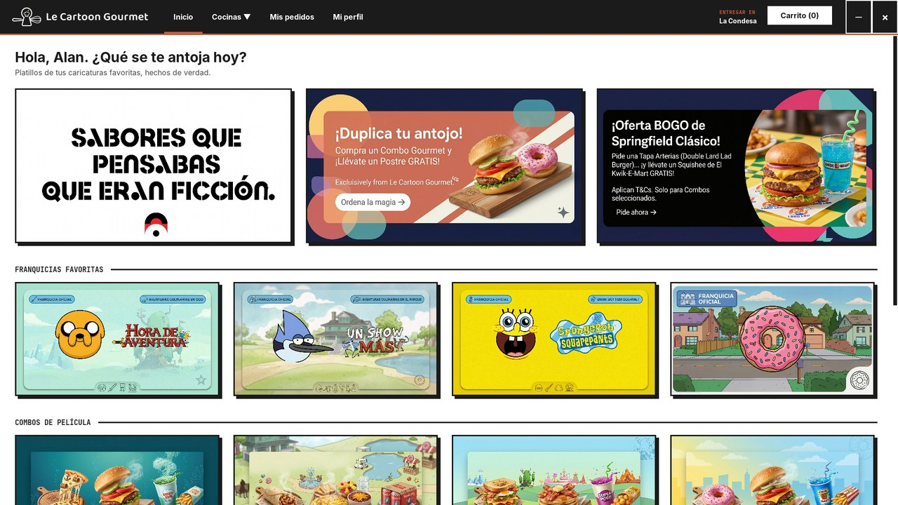
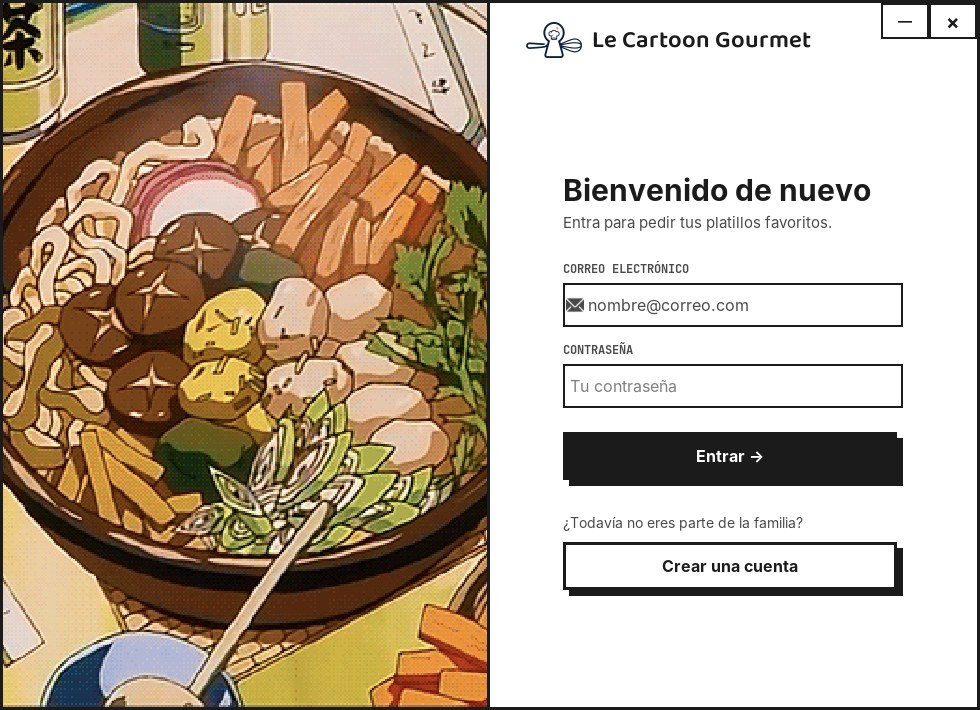
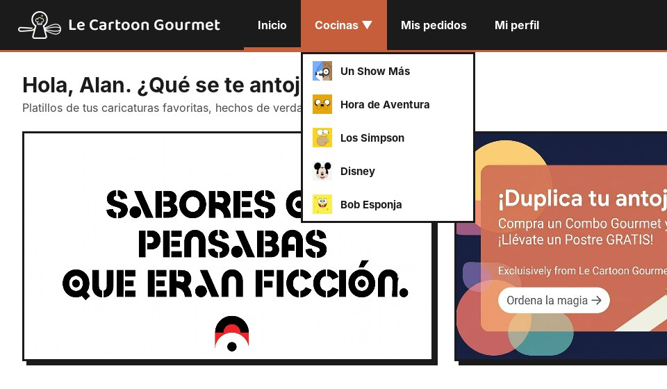
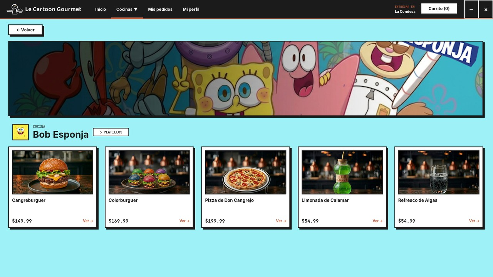
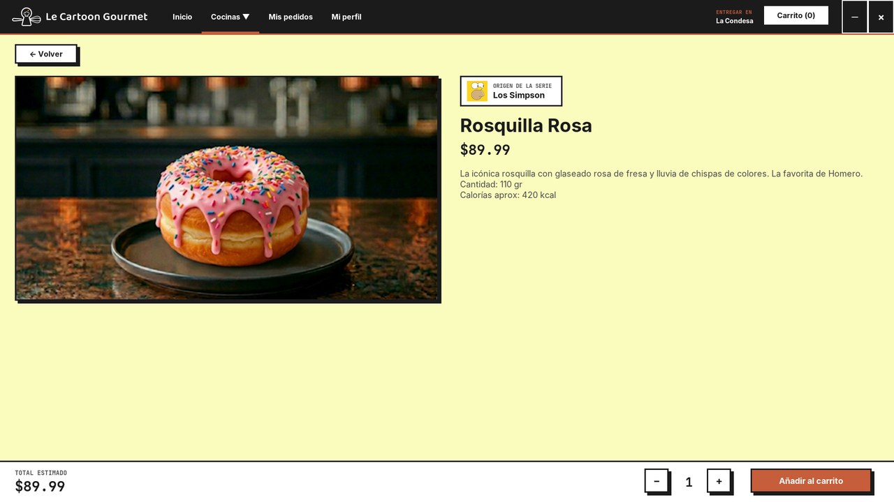
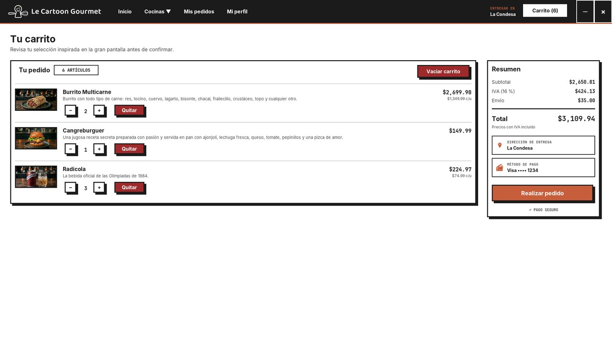
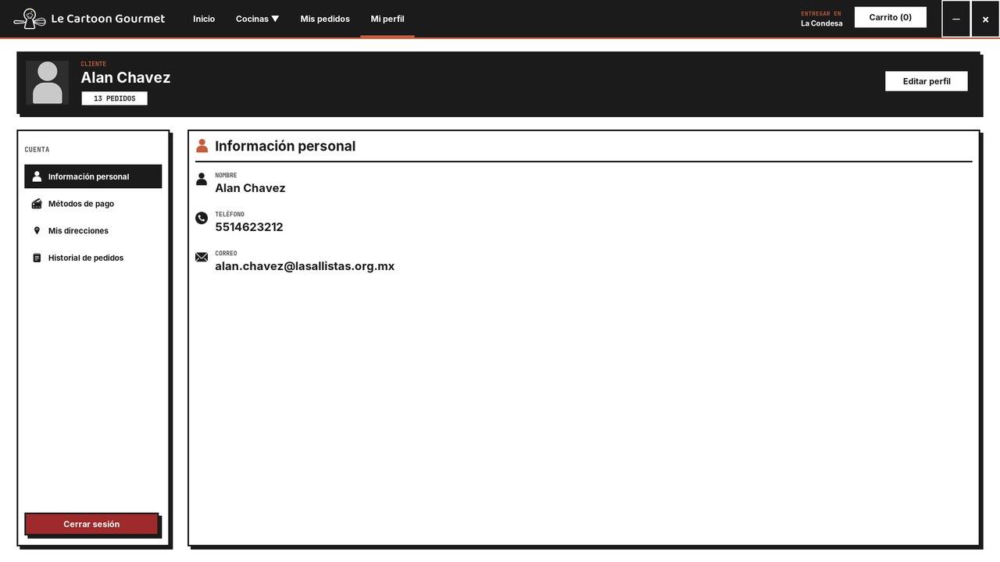
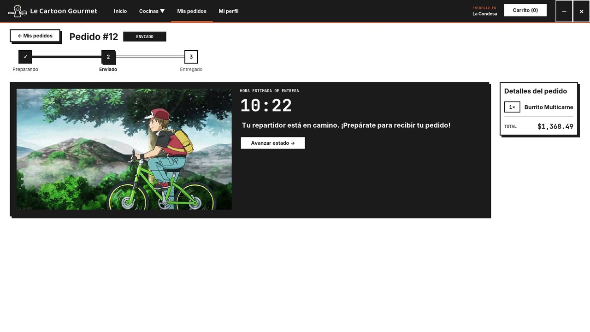
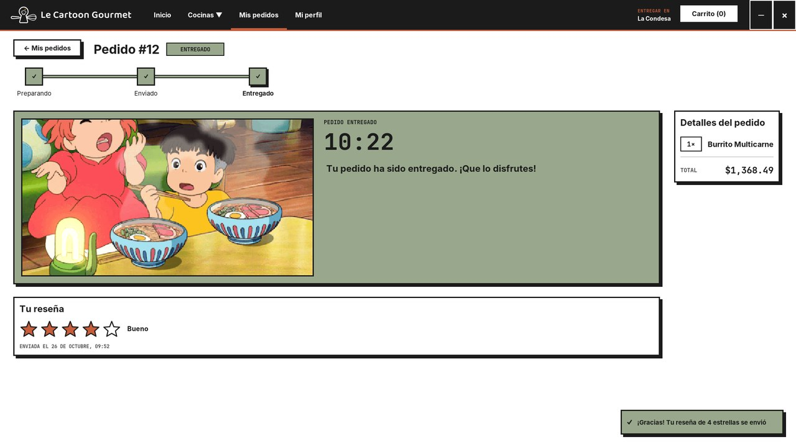
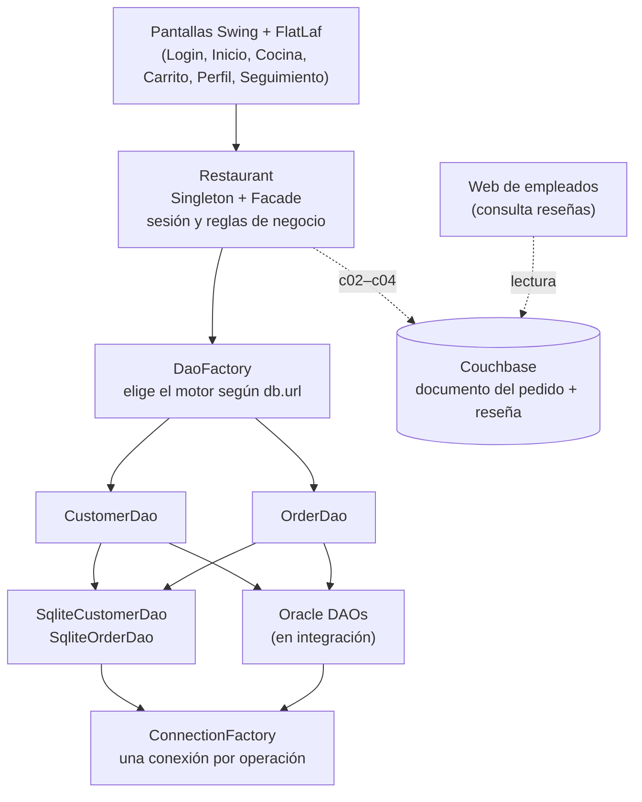

<div align="center">

# 🍔 Le Cartoon Gourmet

**Dark kitchen de comida inspirada en caricaturas.**
Aplicación de escritorio en Java para pedir platillos de *Hora de Aventura*, *Un Show Más*, *Bob Esponja*, *Los Simpson* y *Disney*, con seguimiento del pedido y reseñas.




</div>

---

## Índice

1. [Sobre el proyecto](#sobre-el-proyecto)
2. [Capturas](#capturas)
3. [Funcionalidades](#funcionalidades)
4. [Arquitectura](#arquitectura)
5. [Patrones de diseño](#patrones-de-diseño)
6. [Bases de datos](#bases-de-datos)
7. [Estructura del proyecto](#estructura-del-proyecto)
8. [Requisitos e instalación](#requisitos-e-instalación)
9. [Configuración de la conexión](#configuración-de-la-conexión)
10. [Sistema de diseño de la interfaz](#sistema-de-diseño-de-la-interfaz)
11. [Estado del proyecto y pendientes](#estado-del-proyecto-y-pendientes)
12. [Equipo](#equipo)
13. [Aviso](#aviso)

---

## Sobre el proyecto

Le Cartoon Gourmet nació en **4.º semestre** como proyecto de Programación Orientada a Objetos: una *dark kitchen* (cocina que solo vende a domicilio) cuyo menú son platillos famosos de caricaturas.

Este semestre se retomó como **proyecto final de *Diseño y Programación de Bases de Datos*** (Ingeniería en Cibernética, Universidad La Salle México). El objetivo es llevar la app a una arquitectura con:

- **Base de datos relacional en Oracle 19c** (servidor de la LCI), con SQLite como respaldo para la demo.
- **Base de datos NoSQL en Couchbase** para el documento del pedido y las reseñas.
- **Una página web para empleados** que consulta las reseñas guardadas en Couchbase.
- Todo el acceso a datos aislado detrás de **interfaces DAO**, para que cambiar de motor no obligue a tocar las pantallas.

> Rama de trabajo: **`data`**.

---

## Capturas

| Inicio de sesión | Menú de cocinas |
|---|---|
|  |  |

| Cocina de una franquicia | Detalle del platillo |
|---|---|
|  |  |

| Carrito | Perfil |
|---|---|
|  |  |

| Seguimiento del pedido | Reseña de un pedido entregado |
|---|---|
|  |  |

---

## Funcionalidades

**Cuenta**
- Registro e inicio de sesión. Al iniciar sesión, `Enter` envía el formulario y los campos vacíos se marcan en rojo.
- Perfil con información personal, método de pago (con el número enmascarado), direcciones e historial de pedidos.
- Edición de nombre, apellidos y teléfono. Los cambios se guardan primero en la base de datos y solo después se actualiza la pantalla.

**Catálogo**
- Pantalla de inicio con promociones, franquicias y combos, en una cuadrícula que se adapta al ancho de la pantalla.
- Una "cocina" por franquicia, con portada y tarjetas de platillos.
- Detalle del platillo con foto, origen de la serie, descripción y selector de cantidad.

**Carrito y pedido**
- `Carrito (n)` en el encabezado, actualizado en todo momento.
- Botones − / + / Quitar / Vaciar, con confirmación antes de vaciar.
- Desglose de **subtotal, IVA (16 %) y envío ($35 MXN)**. Los precios ya incluyen IVA; el carrito solo lo desglosa.
- El pedido y sus renglones se guardan **en una sola transacción**.

**Seguimiento y reseñas**
- *Stepper* con las tres etapas del pedido: **Preparando → Enviado → Entregado**.
- Color, GIF animado y mensaje distintos en cada etapa (patrón **State**).
- En un pedido **entregado**, el cliente lo califica con **1 a 5 estrellas** y un comentario opcional de hasta 500 caracteres.

---

## Arquitectura



**Reglas que sigue el código**

- Las pantallas **no** hablan con la base de datos: todo pasa por `Restaurant`, que delega en los DAO.
- Los DAO lanzan `DaoException` (*unchecked*, con la `SQLException` original como causa). Cada pantalla la atrapa y decide qué mensaje mostrar.
- **Primero se guarda y luego se pinta:** la interfaz solo cambia si la base de datos aceptó el cambio. Si no, se revierte; por ejemplo, el estado de un pedido regresa al anterior.
- Con dos motores, la regla del pedido es: **commit en Oracle → después el documento en Couchbase**. Si Couchbase falla, se registra el error y el pedido sigue vigente, porque no hay transacción entre motores.

---

## Patrones de diseño

| Patrón | Dónde | Para qué |
|---|---|---|
| **Singleton** | `Restaurant.getInstance()` | Una sola sesión y un solo punto de acceso a las reglas de negocio. |
| **Facade** | `Restaurant` | Las pantallas llaman a `login`, `registrarPedido`, `cambiarEstado`… sin conocer los DAO. |
| **DAO** | `CustomerDao`, `OrderDao` y sus implementaciones | Aísla el SQL. Cambiar de SQLite a Oracle no toca la interfaz. |
| **Factory** | `DaoFactory`; fábricas de `Buttons` (`primario`, `acento`, `peligro`, `nav`…) | Decide qué implementación o qué estilo crear en un solo lugar. |
| **State** | `Order` + `Preparing` → `Sent` → `Delivered` | Cada estado define su color, GIF, mensaje y cuál es el siguiente. |

En Couchbase, el documento del pedido usa los patrones **Embedding** (platillos y reseña dentro del pedido), **Extended Reference** (datos del cliente y del repartidor copiados al documento) y **Schema Versioning** (campo `version`).

---

## Bases de datos

### Relacional

La app funciona hoy sobre **SQLite** (`Restaurant.db`, incluida en el repo para la demo). El esquema definitivo en **Oracle 19c** lo diseña el equipo, con llaves alternas, vistas y *triggers* de autoincremento e histórico.

Tablas del modelo actual en SQLite:

| Tabla | Columnas |
|---|---|
| `COSTUMERS` | `ID`, `NAME`, `LASTNAME`, `PHONE`, `EMAIL`, `PASSWORD`, `ADDRESS` |
| `FRANCHISE` | `ID`, `NAME` |
| `DISHES` | `ID`, `NAME`, `PRICE` |
| `ORDERS` | `ID`, `COSTUMER`, `PRICE`, `STATE` (1 = Preparando, 2 = Enviado, 3 = Entregado) |
| `ORDERSDETAILS` | `IDORDER`, `DISH`, `QUANTITY` |

> ⚠️ `Restaurant.db` cambia cada vez que se usa la app. Antes de cada commit, con la app cerrada: `git restore Restaurant.db`.

### NoSQL (Couchbase), en integración

Cada pedido se guarda también como documento. La reseña va **embebida** en el pedido, porque cada pedido tiene a lo más una y siempre se leen juntos:

```json
{
  "version": 1,
  "id_pedido": 14,
  "cliente":  { "id": 1, "nombre": "…" },
  "sucursal": "…",
  "creado_en": "2026-10-25T19:40:00",
  "actualizado_en": "2026-10-25T20:01:00",
  "platillos": [ { "nombre": "Burrito Multicarne", "cantidad": 1, "precio_unitario": 1349.99 } ],
  "estado": "Entregado",
  "repartidor": { "…": "…" },
  "resena": { "estrellas": 4, "comentario": "Llegó caliente y enorme", "fecha": "2026-10-25T20:01:00" }
}
```

`estrellas` es un **entero de 1 a 5**. La clase `Resena` lo valida, y así la web puede sacar promedios y filtrar por calificación.

---

## Estructura del proyecto

```
src/main/java
├── Restaurante_Completo/LeCartoon_Original/
│   ├── App.java                 ← punto de entrada (instala el tema y abre el login)
│   ├── Login_Window.java, Register_Window.java, Acceso.java
│   ├── Main_Frame.java          ← ventana principal: header + panel dinámico
│   ├── MainFramePanel.java      ← inicio
│   ├── FranchiseDetails.java    ← cocina de una franquicia
│   ├── OrderDetails_2.java      ← detalle del platillo
│   ├── CartPanel.java, Carrito.java
│   ├── Restaurant.java          ← Singleton + Facade
│   ├── Order.java, State.java, Preparing.java, Sent.java, Delivered.java
│   ├── Costumer.java, OrderDetails.java, Resena.java
│   └── Buttons.java, PromoCard.java
├── OrderDetails/                ← seguimiento: Details, Stepper, Estrellas, ResenaPanel
├── ProfileScreens/              ← perfil, pago, direcciones, historial, editar perfil
├── Dishes/  Franchises/         ← catálogo (platillos y franquicias)
├── persistence/                 ← ConnectionFactory, DaoFactory, interfaces DAO, PruebaConexion
│   └── sqlite/                  ← SqliteCustomerDao, SqliteOrderDao
└── ui/
    ├── Toast.java               ← avisos flotantes
    └── theme/                   ← Theme, Tarjeta, Lienzo, Grilla, Imagen

src/main/resources
├── db.properties                ← conexión por defecto (SQLite)
├── Backgrounds/  DishesP/       ← portadas, logos y fotos de platillos
└── Restaurante_Completo/LeCartoon_Original/  ← FONTS, GIF, IMAGES
```

---

## Requisitos e instalación

| Requisito | Versión |
|---|---|
| JDK | **21** |
| Maven | 3.9+ (o el que trae Eclipse) |
| IDE | Eclipse IDE for Java Developers (recomendado) |

Dependencias principales (las descarga Maven): FlatLaf 3.7.2, fuentes Inter y JetBrains Mono para FlatLaf, `sqlite-jdbc` 3.53, `ojdbc11` 23.5 y JUnit 5.

**Eclipse**

1. `File → Import → Maven → Existing Maven Projects` y elige la carpeta del repo.
2. Clic derecho en el proyecto → `Maven → Update Project…`.
3. Si algo raro aparece al compilar: `Project → Clean…`.
4. Ejecuta `Restaurante_Completo.LeCartoon_Original.App` como *Java Application*.

**Línea de comandos**

```powershell
git clone -b data https://github.com/Jesusjes00/Le-cartoon-Gourtmet.git
cd Le-cartoon-Gourtmet
mvn compile
```

La primera vez, crea tu cuenta desde **"Crear una cuenta"** en la pantalla de inicio de sesión.

---

## Configuración de la conexión

`ConnectionFactory` busca cada valor en este orden, y usa el primero que encuentra:

1. Propiedad del sistema `-D` (por ejemplo `-Ddb.url=…` en la Run Configuration).
2. Variable de entorno `LECARTOON_*`.
3. `src/main/resources/db.properties`.

| Propiedad | Variable de entorno | Por defecto |
|---|---|---|
| `db.url` | `LECARTOON_DB_URL` | `jdbc:sqlite:Restaurant.db` |
| `db.user` | `LECARTOON_DB_USER` | *(vacío)* |
| `db.password` | `LECARTOON_DB_PASSWORD` | *(vacío)* |

`DaoFactory` elige el motor según la URL: `jdbc:oracle:…` → Oracle; cualquier otra → SQLite.

**Credenciales de Oracle (Windows, una vez por equipo):**

```powershell
setx LECARTOON_DB_USER "tu_usuario"
setx LECARTOON_DB_PASSWORD "tu_contraseña"
# Reinicia Eclipse para que las tome.
```

La URL de Oracle va en la pestaña *Environment* de la Run Configuration. Para probar solo la conexión, ejecuta `persistence.PruebaConexion`, que imprime el usuario, la hora del servidor y la versión.

> 🔒 Nunca subas usuarios ni contraseñas al repositorio: usa variables de entorno.
> Plan B para la demo: quitar `LECARTOON_DB_URL` o usar `-Ddb.url=jdbc:sqlite:Restaurant.db`.

---

## Sistema de diseño de la interfaz

Estilo **neo-brutalista**: bordes gruesos, sombras duras sin desenfoque, esquinas rectas y pocos colores.

| Rol | Color | Uso |
|---|---|---|
| Negro (`TINTA`) | `#1B1B1B` | Barra de navegación, botón primario, bordes, sombras y texto |
| Terracota (`TERRACOTA`) | `#C65D3B` | Acento: pestaña activa, *hover*, acción principal de cada pantalla, estado Preparando |
| Blanco (`BLANCO`) | `#FFFFFF` | Fondos y tarjetas |
| Salvia (`SALVIA`) | `#99A88C` | Estado Entregado, avisos de éxito |
| Ladrillo / Vino | `#9E2A2B` / `#540B0E` | Acciones peligrosas: Quitar, Vaciar, Cerrar sesión |

- **Tipografías:** Inter (texto), JetBrains Mono (precios, cantidades y etiquetas) y Baloo 2 (solo el logotipo).
- **Componentes propios** (`ui.theme` y `Buttons`):
  - `Tarjeta`: borde de 3 px y sombra de 6 px; con `hacerClicable` la sombra se vuelve terracota al pasar el mouse.
  - `Buttons`, con estilos `primario`, `acento` (uno por pantalla), `secundario`, `peligro`, `nav`, `control` y `chip`.
  - `Grilla`: columnas que se adaptan al ancho.
  - `Lienzo`: panel para *scroll* que nunca genera barra horizontal.
  - `Imagen`: escala sin deformar, en modo *cover*, con caché.
  - `Toast`: avisos flotantes de éxito y advertencia.
- Todas las pantallas usan *layouts* en lugar de posiciones fijas. Se probaron a **1366×768, 1536×864 y 1920×1080**.

---

## Estado del proyecto y pendientes

**Hecho**
- [x] Código muerto eliminado, IDs generados por la base de datos y pedido guardado en una transacción
- [x] Capa DAO (`CustomerDao`, `OrderDao`), `DaoFactory` y `Restaurant` como Singleton + Facade
- [x] `ConnectionFactory` con credenciales por `-D`, variables de entorno y `db.properties`
- [x] Driver de Oracle (`ojdbc11`) y prueba de conexión al servidor
- [x] Carrito con controles, estado vacío e IVA desglosado
- [x] Rediseño completo de la interfaz: header, inicio, cocina, platillo, carrito, perfil, seguimiento con *stepper*, login y registro
- [x] Interfaz de reseñas (1 a 5 estrellas y comentario)

**En curso**
- [ ] Esquema y datos semilla en Oracle; `OracleDishDao`, `OracleCustomerDao` y `OracleOrderDao`
- [ ] Catálogo leído desde la base de datos (`DishDao`)
- [ ] Conexión a Couchbase; documento del pedido al confirmar; actualización al cambiar de estado
- [ ] Reseñas guardadas en Couchbase (hoy se guardan en memoria mientras la app está abierta)
- [ ] Página web de empleados para consultar reseñas
- [ ] Contraseñas con *hash* (PBKDF2)
- [ ] Reporte de ventas con vistas
- [ ] Prueba final con los dos motores y diagrama de clases

---

## Equipo

| Integrante | Participación |
|---|---|
| **Jesús Eduardo Jiménez García** | Aplicación Java: capa de datos, integración con Oracle y Couchbase, interfaz |
| **Alan Chávez** | Esquema de Oracle y Couchbase, web de empleados |
| **Ángel Hernández** | *(por completar)* |
| **Brenda** | *(por completar)* |

Universidad La Salle México · Ingeniería en Cibernética · *Diseño y Programación de Bases de Datos* · 2026

---

## Aviso

Proyecto **académico y sin fines de lucro**. Los personajes, nombres, logotipos e imágenes de *Hora de Aventura*, *Un Show Más*, *Bob Esponja*, *Los Simpson*, *Disney* y de las películas cuyos GIF aparecen en la app pertenecen a sus respectivos dueños. Se usan solo con fines educativos.
