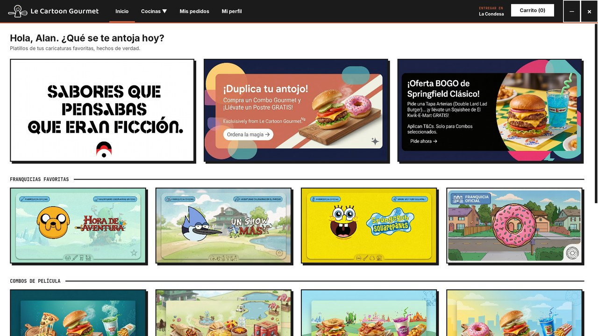
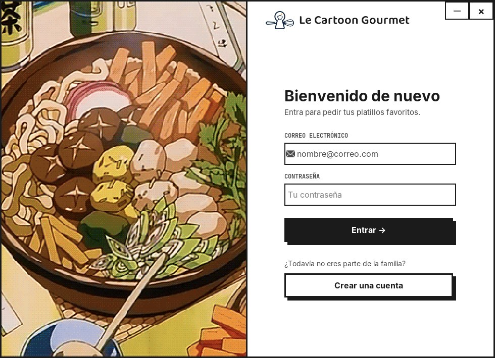
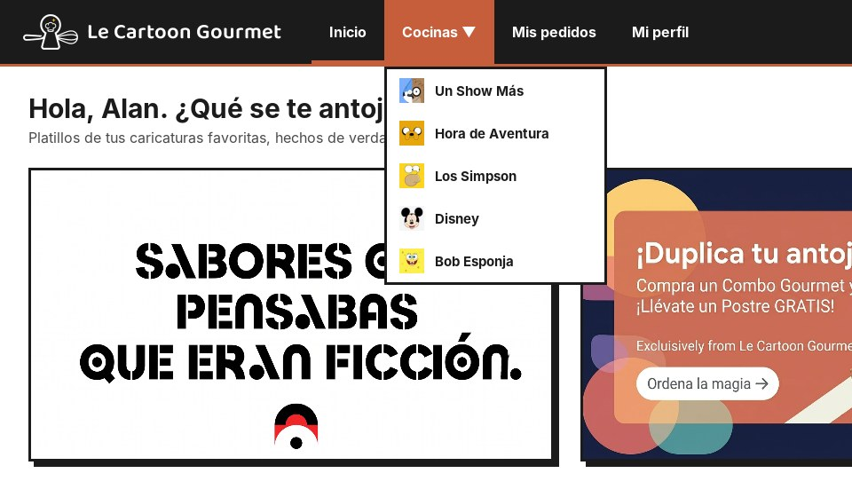
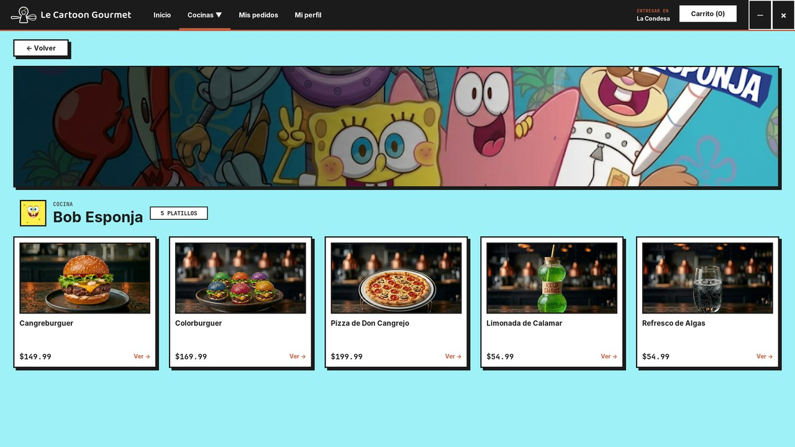
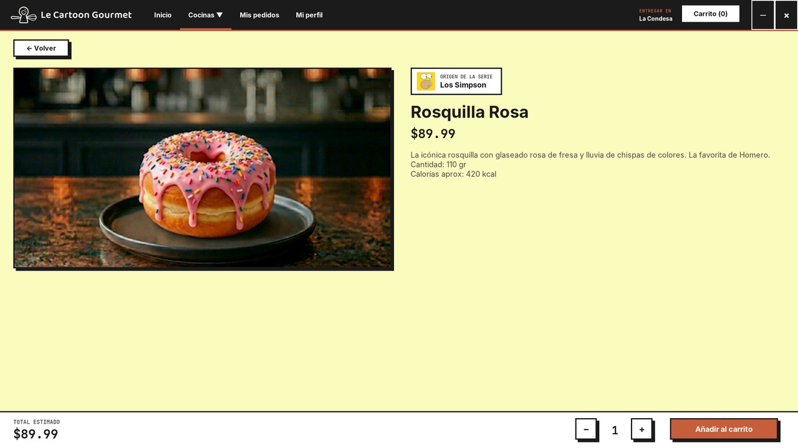
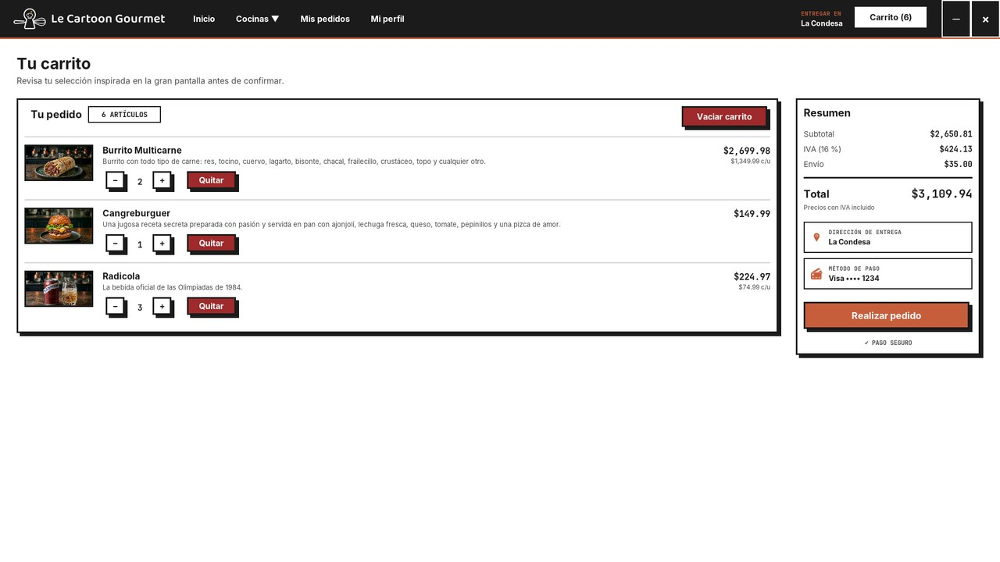
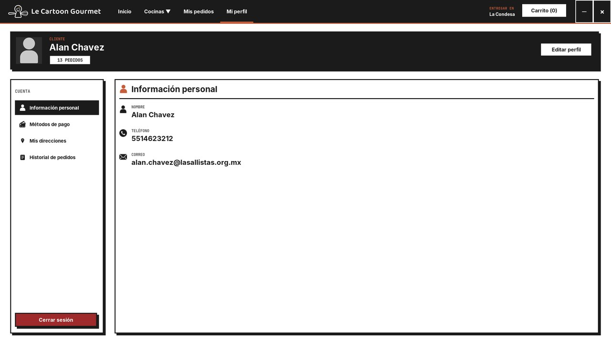
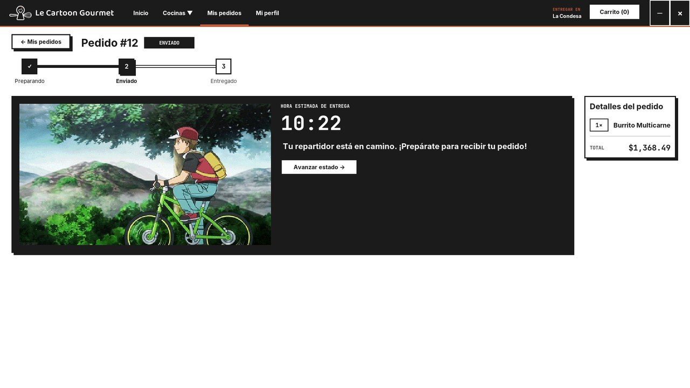
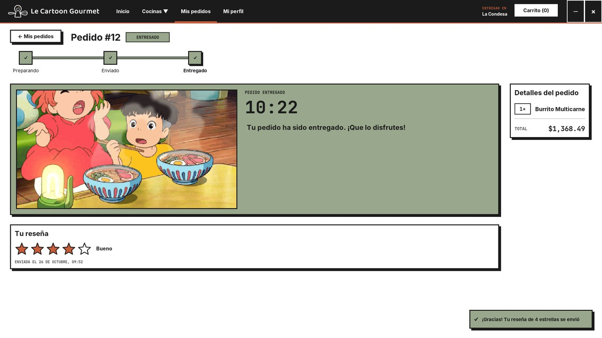
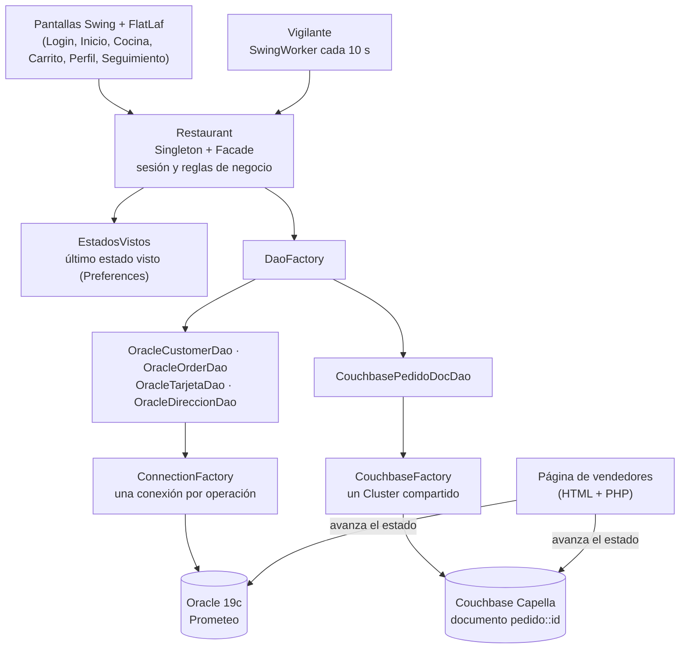

<div align="center">

# 🍔 Le Cartoon Gourmet

**Dark kitchen de comida inspirada en caricaturas.**
Aplicación de escritorio en Java para pedir platillos de *Hora de Aventura*, *Un Show Más*, *Bob Esponja*, *Los Simpson* y *Disney*, con seguimiento del pedido en tiempo casi real y reseñas.




</div>

---

## Índice

1. [Sobre el proyecto](#sobre-el-proyecto)
2. [Capturas](#capturas)
3. [Funcionalidades](#funcionalidades)
4. [Arquitectura](#arquitectura)
5. [Patrones de diseño](#patrones-de-diseño)
6. [Bases de datos](#bases-de-datos)
7. [Seguridad](#seguridad)
8. [Estructura del proyecto](#estructura-del-proyecto)
9. [Requisitos e instalación](#requisitos-e-instalación)
10. [Configuración de la conexión](#configuración-de-la-conexión)
11. [Sistema de diseño de la interfaz](#sistema-de-diseño-de-la-interfaz)
12. [Aprendizajes](#aprendizajes)
13. [Limitaciones conocidas y siguientes pasos](#limitaciones-conocidas-y-siguientes-pasos)
14. [Equipo](#equipo)
15. [Licencia y aviso](#licencia-y-aviso)

> 📘 **¿Quieres saber cómo funciona cada clase?** La [referencia técnica](docs/REFERENCIA_TECNICA.md) explica clase por clase, con sus constructores, métodos, interfaces y los flujos completos (login, pedido, cambio de estado y reseña).

---

## Sobre el proyecto

Le Cartoon Gourmet nació en **4.º semestre** como proyecto de Programación Orientada a Objetos: una *dark kitchen* (cocina que solo vende a domicilio) cuyo menú son platillos famosos de caricaturas.

En **5.º semestre** se retomó como **proyecto final de *Diseño y Programación de Bases de Datos*** (Ingeniería en Cibernética, Universidad La Salle México) y se llevó a esta arquitectura:

- **Oracle 19c** (servidor Prometeo de la LCI) como base relacional y fuente de verdad: clientes, direcciones, tarjetas, pedidos, repartidores y reseñas.
- **Couchbase Capella** como base NoSQL: cada pedido se copia como documento JSON, con la reseña embebida.
- **Una página web para vendedores** (HTML + PHP, hecha por el equipo) que avanza los pedidos escribiendo en las dos bases; la app de escritorio detecta el cambio sola.
- Todo el acceso a datos aislado detrás de **interfaces DAO**: la migración de SQLite a Oracle no tocó ninguna pantalla.

> **Versión entregada:** etiqueta [`v1.0`](https://github.com/Jesusjes00/Le-cartoon-Gourtmet/tree/v1.0) (noviembre 2026). El proyecto seguirá evolucionando con otras tecnologías; esta versión queda como registro de su etapa en Java.

---

## Capturas

| Inicio de sesión | Menú de cocinas |
|---|---|
|  |  |

| Cocina de una franquicia | Detalle del platillo |
|---|---|
|  |  |

| Carrito | Perfil |
|---|---|
|  |  |

| Seguimiento del pedido | Reseña de un pedido entregado |
|---|---|
|  |  |

---

## Funcionalidades

**Cuenta y perfil**
- Registro e inicio de sesión. Al iniciar sesión, `Enter` envía el formulario y los campos vacíos se marcan en rojo.
- Perfil con información personal, método de pago, dirección de entrega e historial de pedidos.
- Edición de nombre, apellidos y teléfono: primero se guarda en la base de datos y solo después se actualiza la pantalla.

**Dirección y pago**
- Dirección de entrega dentro de la zona de cobertura: al escribir el código postal se cargan sus colonias desde Oracle.
- Tarjetas validadas con el **algoritmo de Luhn**, CVV de 3 o 4 dígitos y fecha de vencimiento. En pantalla solo se muestran la marca y los últimos 4 dígitos.
- Para pedir se necesita una dirección y una tarjeta **vigente**.

**Catálogo, carrito y pedido**
- Pantalla de inicio con promociones, franquicias y combos, en una cuadrícula que se adapta al ancho de la pantalla.
- Una "cocina" por franquicia y detalle de cada platillo con foto, serie de origen, descripción y cantidad.
- Carrito con − / + / Quitar / Vaciar y desglose de **subtotal, IVA (16 %) y envío ($35 MXN)**.
- El pedido se asigna a la **sucursal de la misma alcaldía** que la dirección de entrega y se guarda con sus renglones **en una sola transacción**; después se copia a Couchbase.

**Seguimiento y reseñas**
- *Stepper* con las tres etapas: **Preparando → Enviado → Entregado**, cada una con su color, GIF y mensaje (patrón **State**).
- Un **vigilante** revisa los pedidos cada 10 s en segundo plano. Si el vendedor avanzó uno, aparece un aviso, se actualiza `Mis pedidos (n)` y, si el pedido está abierto, el seguimiento se **desliza** al estado nuevo.
- Al pasar a **Enviado** se asigna un repartidor de la sucursal, en Oracle y en el documento de Couchbase.
- En un pedido **entregado**, el cliente lo califica con **1 a 5 estrellas** y un comentario opcional de hasta 300 caracteres. La reseña se guarda en Oracle y en Couchbase.

---

## Arquitectura



Las pantallas dependen de las interfaces `CustomerDao`, `OrderDao`, `TarjetaDao`, `DireccionDao` y `PedidoDocDao`, nunca de las clases de Oracle o Couchbase.

**Reglas que sigue el código**

- Las pantallas **no** hablan con la base de datos: todo pasa por `Restaurant`, que delega en los DAO.
- Los DAO lanzan `DaoException` (*unchecked*, con la excepción original como causa). Cada pantalla la atrapa y decide qué mensaje mostrar.
- **Primero se guarda y luego se pinta:** la interfaz solo cambia si la base de datos aceptó el cambio.
- **Oracle primero, Couchbase después.** No hay transacción entre los dos motores, así que el pedido se confirma en Oracle y luego se copia el documento. Si Couchbase falla, se registra `[Couchbase] … quedó solo en Oracle` y el cliente no pierde su pedido.
- Las operaciones lentas (la primera conexión a Couchbase, la revisión de pedidos) corren fuera del hilo de la interfaz para que la ventana nunca se congele.

> El detalle de cada clase y método está en la [referencia técnica](docs/REFERENCIA_TECNICA.md).

---

## Patrones de diseño

| Patrón | Dónde | Para qué |
|---|---|---|
| **Singleton** | `Restaurant.getInstance()`, `CouchbaseFactory` | Una sola sesión y un solo `Cluster` de Couchbase para toda la app. |
| **Facade** | `Restaurant` | Las pantallas llaman a `login`, `registrarPedido`, `calificar`… sin conocer los DAO ni el orden Oracle → Couchbase. |
| **DAO** | `CustomerDao`, `OrderDao`, `TarjetaDao`, `DireccionDao`, `PedidoDocDao` | Aísla el SQL y el SDK de Couchbase. La migración de SQLite a Oracle no tocó ni las pantallas ni `Restaurant`. |
| **Factory** | `DaoFactory`; fábricas de `Buttons` (`primario`, `acento`, `peligro`, `nav`…) | Decide en un solo lugar qué implementación o qué estilo crear. |
| **State** | `Order` + `Preparing` → `Sent` → `Delivered` | Cada estado define su color, GIF, mensaje y cuál es el siguiente, sin cadenas de `if`. |

En Couchbase, el documento del pedido usa los patrones **Embedding** (renglones y reseña dentro del pedido), **Extended Reference** (copia del cliente, la dirección y el repartidor) y **Schema Versioning** (campo `version`).

---

## Bases de datos

### Relacional: Oracle 19c

El esquema tiene 25 tablas normalizadas (más sus 25 tablas `_H` de histórico), con secuencias y *triggers* de autoincremento, validación y auditoría.

| Operación | Tablas |
|---|---|
| Login, registro y perfil | `CLIENTE`, `PERSONA`, `TELEFONO` |
| Dirección de entrega | `DIRECCION`, `PERSONA_DIRECCION`, `CALLE` y el catálogo `PAIS` … `COLONIA` |
| Pago | `TARJETA_CLIENTE` |
| Pedido, sucursal y repartidor | `PEDIDO`, `DETALLES_PEDIDO`, `PLATILLO`, `SUCURSAL`, `REPARTIDOR` |
| Reseña | `PEDIDO.CALIFICACION` (1 a 5) y `PEDIDO.RESENA` |

- Los ids los pone Oracle (secuencia + *trigger*); Java los recupera con `prepareStatement(sql, new String[] { "ID_…" })`.
- El total del pedido no se guarda: se calcula como `SUM(cantidad × precio) + envío`.
- `PEDIDO.ID_REPARTIDOR` acepta `NULL`: el repartidor se asigna al pasar a **Enviado**.
- Cada cambio queda en `PEDIDO_H`, `CLIENTE_H`, `PERSONA_H`… gracias a los *triggers* de histórico.

### NoSQL: Couchbase Capella

Cada pedido se guarda también como documento en `ProyectoFinal.lecartoon.pedido`, con la llave **`pedido::<id de Oracle>`**. La reseña va **embebida**, porque cada pedido tiene a lo más una y siempre se leen juntos. Ejemplo (datos ficticios):

```json
{
  "id_pedido": 14,
  "cliente": { "id_cliente": 1, "nombre": "Laura Gómez Pérez", "telefono": "5500000000" },
  "repartidor": { "id_repartidor": 3, "nombre": "Carlos Ruiz", "telefono": "5511111111" },
  "id_sucursal": 2,
  "id_estado": 3,
  "direccion": {
    "pais": "México", "estado": "CDMX", "ciudad": "Ciudad de México", "municipio": "Benito Juárez",
    "cp": "03100", "colonia": "Del Valle", "calle": "Insurgentes Sur", "numExterior": "300"
  },
  "detalles": [
    { "id_platillo": 7, "nombre": "Burrito Multicarne", "cantidad": 1, "precio": 1349.99 }
  ],
  "subtotal": 1349.99,
  "fechaCreacion": "25-10-2026 19:40:00",
  "fechaActualizacion": "25-10-2026 20:01:00",
  "resena": { "calificacion": 4, "comentarios": "Llegó caliente y enorme" },
  "version": 1
}
```

- Se crea con `insert`, que falla si la llave ya existe: así un choque de ids no pisa un documento.
- La reseña y el repartidor se actualizan con `mutateIn` (sub-documento), sin reescribir todo el pedido.
- `precio` es el precio **al momento de la compra**; Oracle calcula el total con el precio actual del platillo.

---

## Seguridad

- **Sin credenciales en el repositorio.** Usuario y contraseña de Oracle y de Couchbase se leen de variables de entorno; `db.properties` solo trae la URL.
- **Mínimo privilegio.** La app puede entrar a Oracle con la cuenta **cliente** (`CIB500_14`), que solo tiene los `GRANT` de la matriz de seguridad del proyecto, en lugar de la cuenta dueña de las tablas. Para no reescribir el SQL, `ConnectionFactory` ejecuta `ALTER SESSION SET CURRENT_SCHEMA` (ver [referencia técnica, sección 3](docs/REFERENCIA_TECNICA.md#3-datos-oracle-couchbase-y-los-dos-modos-de-conexión)).
- **Sin inyección SQL.** Todas las consultas de los DAO usan `PreparedStatement`. El único valor que se concatena (el nombre del esquema en el `ALTER SESSION`) se valida con una expresión regular al arrancar.
- **Datos de pago enmascarados:** la app nunca lee el número completo ni el CVV de Oracle; solo pide el primer dígito (para la marca) y los últimos 4.

Lo que falta en este tema está en [Limitaciones conocidas](#limitaciones-conocidas-y-siguientes-pasos).

---

## Estructura del proyecto

```
src/main/java
├── Restaurante_Completo/LeCartoon_Original/
│   ├── App.java                 ← punto de entrada (tema, login y pre-conexión a Couchbase)
│   ├── Login_Window.java, Register_Window.java, Acceso.java
│   ├── Main_Frame.java          ← ventana principal: header + panel dinámico + vigilante
│   ├── MainFramePanel.java      ← inicio
│   ├── FranchiseDetails.java    ← cocina de una franquicia
│   ├── OrderDetails_2.java      ← detalle del platillo
│   ├── CartPanel.java, Carrito.java
│   ├── Restaurant.java          ← Singleton + Facade
│   ├── EstadosVistos.java       ← último estado que vio el cliente
│   ├── Order.java, State.java, Preparing.java, Sent.java, Delivered.java
│   ├── Costumer.java, Direccion.java, MetodoPago.java, Resena.java, Repartidor.java, ZonaCobertura.java
│   └── Buttons.java, PromoCard.java
├── OrderDetails/                ← seguimiento: Details, Stepper, Estrellas, ResenaPanel
├── ProfileScreens/              ← perfil, pago, dirección, historial, editar perfil
├── Dishes/  Franchises/         ← catálogo (platillos y franquicias)
├── persistence/                 ← ConnectionFactory, DaoFactory, interfaces DAO y pruebas de conexión
│   ├── oracle/                  ← OracleCustomerDao, OracleOrderDao, OracleTarjetaDao, OracleDireccionDao
│   └── couchbase/               ← CouchbaseFactory, CouchbasePedidoDocDao
└── ui/
    ├── Toast.java, PanelSwipe.java
    └── theme/                   ← Theme, Tarjeta, Lienzo, Grilla, Imagen

src/main/resources
├── db.properties                ← URL de Oracle y esquema (sin usuario ni contraseña)
├── Backgrounds/  DishesP/       ← portadas, logos y fotos de platillos
└── Restaurante_Completo/LeCartoon_Original/  ← FONTS, GIF, IMAGES

docs/
├── REFERENCIA_TECNICA.md        ← clase por clase
└── capturas/
```

---

## Requisitos e instalación

| Requisito | Versión |
|---|---|
| JDK | **21** |
| Maven | 3.9+ (o el que trae Eclipse) |
| IDE | Eclipse IDE for Java Developers (recomendado) |

Dependencias principales (las descarga Maven): FlatLaf 3.7.2 con las fuentes Inter y JetBrains Mono, `ojdbc11` 23.5, el SDK de Couchbase `java-client` 3.9.2 y JUnit 5.

> ⚠️ **La app necesita las bases del proyecto para funcionar:** el Oracle de Prometeo solo es accesible desde la red de la universidad, y el cluster de Couchbase Capella es privado. Sin ellas compila, pero no puede iniciar sesión. Para ver cómo funciona, revisa las [capturas](#capturas) y la [referencia técnica](docs/REFERENCIA_TECNICA.md).

**Eclipse**

1. `File → Import → Maven → Existing Maven Projects` y elige la carpeta del repo.
2. Clic derecho en el proyecto → `Maven → Update Project…`.
3. Configura las variables de entorno (ver la sección siguiente) en la pestaña *Environment* de la Run Configuration.
4. Ejecuta `Restaurante_Completo.LeCartoon_Original.App` como *Java Application*.

**Línea de comandos**

```powershell
git clone https://github.com/Jesusjes00/Le-cartoon-Gourtmet.git
cd Le-cartoon-Gourtmet
mvn compile
```

---

## Configuración de la conexión

`ConnectionFactory` busca cada valor en este orden y usa el primero que encuentra:

1. Propiedad del sistema `-D` (por ejemplo `-Ddb.url=…` en la Run Configuration).
2. Variable de entorno `LECARTOON_*`.
3. `src/main/resources/db.properties`.

**Oracle**

| Propiedad | Variable de entorno | Por defecto |
|---|---|---|
| `db.url` | `LECARTOON_DB_URL` | `jdbc:oracle:thin:@//200.13.89.10:1521/pdbcib.lci.ulsa.mx` |
| `db.user` | `LECARTOON_DB_USER` | *(vacío)* |
| `db.password` | `LECARTOON_DB_PASSWORD` | *(vacío)* |
| `db.schema` | `LECARTOON_DB_SCHEMA` | `CIB500_05` (dueño de las tablas) |

El usuario decide el **modo de conexión**: con el dueño de las tablas (`CIB500_05`) la app tiene todos los permisos; con la cuenta cliente (`CIB500_14`) entra con mínimo privilegio y apunta al esquema del dueño.

**Couchbase**

| Variable de entorno | Valor en el proyecto |
|---|---|
| `LECARTOON_CB_URL` | `couchbases://…` (cadena de conexión de Capella) |
| `LECARTOON_CB_USER` / `LECARTOON_CB_PASSWORD` | Usuario de *Database Access* de Capella |
| `LECARTOON_CB_BUCKET` | `ProyectoFinal` |
| `LECARTOON_CB_SCOPE` / `LECARTOON_CB_COLLECTION` | `lecartoon` / `pedido` (si faltan, `_default`) |

**Ejemplo en Windows (una vez por equipo):**

```powershell
setx LECARTOON_DB_USER "tu_usuario"
setx LECARTOON_DB_PASSWORD "tu_contraseña"
# Reinicia Eclipse para que las tome.
```

Para probar solo las conexiones: `persistence.PruebaConexion` (Oracle: usuario, esquema, hora del servidor, versión y permisos sobre cada tabla) y `persistence.PruebaCouchbase`.

> 🔒 Nunca subas usuarios ni contraseñas al repositorio: usa variables de entorno.

---

## Sistema de diseño de la interfaz

Estilo **neo-brutalista**: bordes gruesos, sombras duras sin desenfoque, esquinas rectas y pocos colores.

| Rol | Color | Uso |
|---|---|---|
| Negro (`TINTA`) | `#1B1B1B` | Barra de navegación, botón primario, bordes, sombras y texto |
| Terracota (`TERRACOTA`) | `#C65D3B` | Acento: pestaña activa, *hover*, acción principal de cada pantalla, estado Preparando |
| Blanco (`BLANCO`) | `#FFFFFF` | Fondos y tarjetas |
| Salvia (`SALVIA`) | `#99A88C` | Estado Entregado, avisos de éxito |
| Ladrillo / Vino | `#9E2A2B` / `#540B0E` | Acciones peligrosas: Quitar, Vaciar, Cerrar sesión |

- **Tipografías:** Inter (texto), JetBrains Mono (precios, cantidades y etiquetas) y Baloo 2 (solo el logotipo).
- **Componentes propios** (`ui`, `ui.theme` y `Buttons`):
  - `Tarjeta`: borde de 3 px y sombra de 6 px; con `hacerClicable` la sombra se vuelve terracota al pasar el mouse.
  - `Buttons`, con estilos `primario`, `acento` (uno por pantalla), `secundario`, `peligro`, `nav`, `control` y `chip`.
  - `Grilla`: columnas que se adaptan al ancho.
  - `Lienzo`: panel para *scroll* que nunca genera barra horizontal.
  - `Imagen`: escala sin deformar, en modo *cover*, con caché.
  - `Toast`: avisos flotantes de éxito y advertencia.
  - `PanelSwipe`: transición deslizante entre dos estados de una pantalla.
- Todas las pantallas usan *layouts* en lugar de posiciones fijas. Se probaron a **1366×768, 1536×864 y 1920×1080**.

---

## Aprendizajes

- **Diseñar para cambiar de motor.** Con interfaces DAO y una fábrica, pasar de SQLite a Oracle (y agregar Couchbase) fue cambiar implementaciones, no pantallas.
- **JDBC con Oracle en serio:** transacciones con `commit`/`rollback`, ids generados por secuencias y *triggers*, manejo de `NULL`, errores `ORA-` traducidos a mensajes para el usuario y lectura consistente entre sesiones.
- **Relacional + NoSQL juntos:** cuándo embeber y cuándo copiar datos en un documento, cómo escribir en dos motores sin transacción compartida y qué hacer cuando uno falla.
- **Seguridad aplicada:** credenciales fuera del código, mínimo privilegio con cuentas y `GRANT` de Oracle, y validación de cualquier valor que se concatene en SQL.
- **Swing moderno:** concurrencia con `SwingWorker` y el hilo de eventos, animaciones propias y un sistema de diseño reutilizable sobre FlatLaf.

---

## Limitaciones conocidas y siguientes pasos

| Limitación | Siguiente paso |
|---|---|
| Las contraseñas se guardan y comparan en texto plano. | Guardarlas con un *hash* lento y con sal (PBKDF2, bcrypt o Argon2). |
| `TARJETA_CLIENTE` guarda el número completo y el CVV (lo exige el esquema académico). | No guardar nunca el CVV y reemplazar el número por un *token* de una pasarela de pago. |
| El catálogo de platillos vive en clases Java; Oracle solo tiene sus ids y precios. | Leerlo desde la base con un `DishDao`. |
| El total en Oracle usa el precio actual del platillo. | Guardar el precio unitario en `DETALLES_PEDIDO` (el documento de Couchbase ya lo hace). |
| El repartidor lo asigna la app del cliente al detectar Enviado (simulación del vendedor). | Que lo asigne la página del vendedor o un *trigger* `BEFORE UPDATE` en Oracle. |
| El carrito no se vacía al cerrar sesión dentro de la misma ejecución. | Vaciarlo en `cerrarSesion()`. |
| Depende de servidores del proyecto que no son públicos. | Empaquetar una base de demostración (por ejemplo Oracle Free en Docker) con scripts de creación. |

---

## Equipo

| Integrante | Participación |
|---|---|
| **Jesús Eduardo Jiménez García** | Aplicación Java: capa de datos, integración con Oracle y Couchbase, interfaz |
| **Alan Chávez Canales** | Esquema de Oracle y Couchbase, página web de vendedores |
| **Ángel Arael Hernández López** | Diseño conceptual y documentación del proyecto presentado en la universidad |
| **Brenda Paola Alonso Tellez** | Diseño conceptual y documentación del proyecto presentado en la universidad |

Universidad La Salle México · Ingeniería en Cibernética · *Diseño y Programación de Bases de Datos* · 2026

---

## Licencia y aviso

El **código** de este repositorio se distribuye bajo la [licencia MIT](LICENSE).

Proyecto **académico y sin fines de lucro**. Los personajes, nombres, logotipos e imágenes de *Hora de Aventura*, *Un Show Más*, *Bob Esponja*, *Los Simpson*, *Disney* y de las películas cuyos GIF aparecen en la app pertenecen a sus respectivos dueños, se usan solo con fines educativos y **no** están cubiertos por la licencia MIT.
