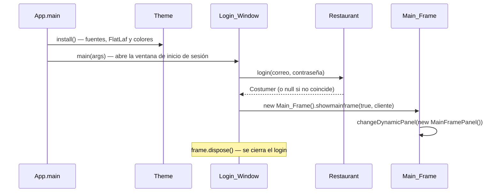
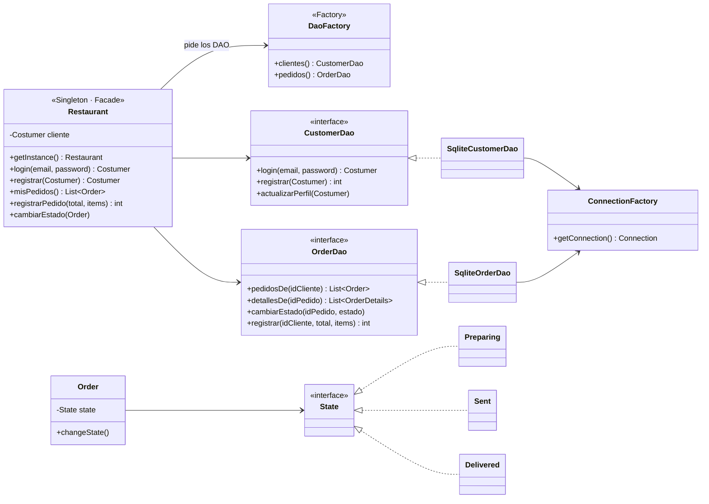
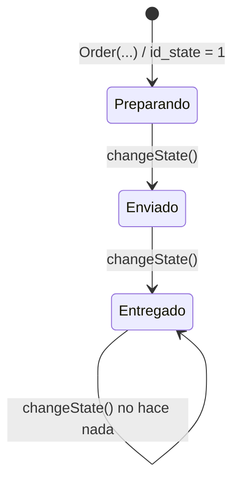
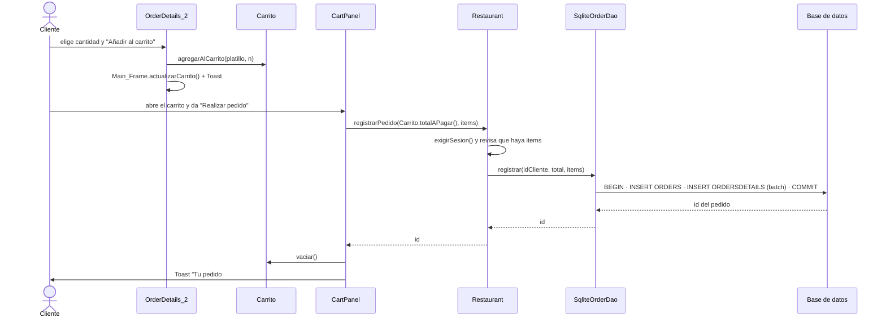
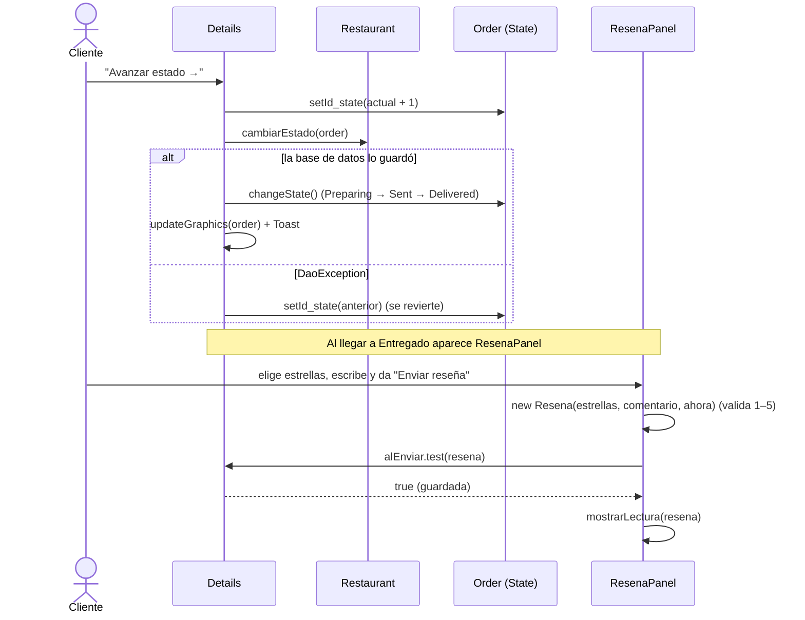

# Referencia técnica · Le Cartoon Gourmet

Documentación clase por clase del código en la rama `data`: qué hace cada clase o interfaz, sus constructores y sus métodos públicos, y cómo se conectan entre sí.

> Para la visión general (capturas, instalación y configuración) ve al [README](../README.md).
> Convención: en las tablas, **`static`** indica método de clase. Los métodos privados solo se mencionan cuando explican cómo funciona algo.

---

## Índice

1. [Cómo arranca la app](#1-cómo-arranca-la-app)
2. [Mapa de paquetes](#2-mapa-de-paquetes)
3. [Núcleo del negocio](#3-núcleo-del-negocio-restaurante_completolecartoon_original)
4. [Patrón State: estados del pedido](#4-patrón-state-estados-del-pedido)
5. [Catálogo: `Dishes` y `Franchises`](#5-catálogo-dishes-y-franchises)
6. [Persistencia: `persistence`](#6-persistencia-persistence)
7. [Pantallas principales](#7-pantallas-principales)
8. [Seguimiento y reseñas: `OrderDetails`](#8-seguimiento-y-reseñas-orderdetails)
9. [Perfil: `ProfileScreens`](#9-perfil-profilescreens)
10. [Componentes de interfaz: `ui` y `ui.theme`](#10-componentes-de-interfaz-ui-y-uitheme)
11. [Flujos completos paso a paso](#11-flujos-completos-paso-a-paso)
12. [Manejo de errores](#12-manejo-de-errores)
13. [Cómo extender el proyecto](#13-cómo-extender-el-proyecto)
14. [Mejoras conocidas](#14-mejoras-conocidas)

---

## 1. Cómo arranca la app

1. **`App.main`** llama a `Theme.install()` **una sola vez**, antes de crear cualquier ventana. Así todos los componentes de Swing nacen ya con el tema.
2. **`Login_Window`** pide correo y contraseña y llama a `Restaurant.getInstance().login(...)`.
3. Si el login sale bien, `Restaurant` guarda al cliente como **sesión**, se crea **`Main_Frame`** y se cierra el login.
4. `Main_Frame` tiene un **header fijo** y un **panel dinámico**: cada pantalla es un `JPanel` que se coloca ahí con `Main_Frame.changeDynamicPanel(panel)`.

---

## 2. Mapa de paquetes

| Paquete | Contenido | Depende de |
|---|---|---|
| `Restaurante_Completo.LeCartoon_Original` | Punto de entrada, modelo (`Costumer`, `Order`, `Resena`…), reglas (`Restaurant`, `Carrito`), pantallas principales y botones | `persistence`, `ui`, `Dishes`, `Franchises` |
| `Dishes` | Clase base `Dishes` y 28 platillos | — |
| `Franchises` | Clase base `Franchises` y 5 franquicias | — |
| `persistence` | Conexión, fábrica de DAO, interfaces DAO y excepción | modelo |
| `persistence.sqlite` | Implementación de los DAO para SQLite | `persistence` |
| `OrderDetails` | Pantalla de seguimiento, *stepper*, estrellas y reseña | núcleo, `ui.theme` |
| `ProfileScreens` | Perfil y sus secciones | núcleo, `ui.theme` |
| `ui` | `Toast` (avisos flotantes) | `ui.theme` |
| `ui.theme` | Tema y componentes visuales reutilizables | FlatLaf |

---

## 3. Núcleo del negocio (`Restaurante_Completo.LeCartoon_Original`)

### `App`

Clase con el `main` de la aplicación.

| Método | Qué hace |
|---|---|
| **`static`** `main(String[] args)` | Llama a `Theme.install()` y abre `Login_Window.main(args)`. |

---

### `Restaurant` · *Singleton + Facade*

`public final class`. Es el **único punto de entrada** de las pantallas a los datos y a las reglas de negocio. Guarda al cliente con sesión iniciada y delega en los DAO.

**Cómo funciona el Singleton:** `private static final Restaurant INSTANCIA = new Restaurant();` crea la instancia al cargar la clase (*eager*). El constructor es `private`, así que nadie más puede hacer `new Restaurant()`.

**Campos**

| Campo | Tipo | Para qué |
|---|---|---|
| `clientes` | `CustomerDao` | Se obtiene de `DaoFactory.clientes()` al crear la instancia. |
| `pedidos` | `OrderDao` | Se obtiene de `DaoFactory.pedidos()`. |
| `cliente` | `Costumer` | Sesión actual; `null` si nadie ha iniciado sesión. |

**Métodos**

| Método | Qué hace |
|---|---|
| **`static`** `getInstance()` | Regresa la única instancia. |
| `login(String email, String password)` | Pide el cliente al DAO. Si existe, lo deja como sesión y lo regresa; si no, regresa `null`. |
| `registrar(Costumer nuevo)` | Inserta al cliente, le asigna el `id` que generó la base de datos (`setId`) y lo deja como sesión. |
| `cerrarSesion()` | Pone la sesión en `null`. |
| `getCliente()` | Cliente con sesión iniciada. |
| `actualizarPerfil(Costumer c)` | Guarda nombre, apellido y teléfono. |
| `misPedidos()` | Pedidos del cliente en sesión, del más nuevo al más viejo. **Exige sesión**. |
| `detallesDe(int idPedido)` | Renglones del pedido (`OrderDetails`). |
| `cambiarEstado(Order pedido)` | Guarda `pedido.getId_state()` en la base de datos. |
| `registrarPedido(double total, List<ItemPedido> items)` | Exige sesión y que el carrito no esté vacío (si lo está, lanza `IllegalArgumentException`). Guarda el pedido y sus renglones en una transacción y regresa el id del pedido. |
| *privado* `exigirSesion()` | Lanza `IllegalStateException` si no hay cliente. |

---

### `Costumer`

Modelo del cliente. *(El nombre conserva la ortografía original del proyecto.)*

| Constructor | Cuándo se usa |
|---|---|
| `Costumer(String name, String lastName, String phone, String email, String password, String address)` | Cliente **nuevo**, antes de guardarlo. Su `id` queda en `-1`. |
| `Costumer(int id, String name, String lastName, String phone, String email, String password, String address)` | Cliente **leído de la base de datos**, ya con su `id`. |

Métodos: *getters* y *setters* de `id`, `name`, `lastName`, `phone`, `email`, `password`; `getAddress()` / `setAddress1(String)`; `toString()`.

---

### `Carrito` y `Carrito.ItemPedido`

`Carrito` guarda el pedido en curso en una lista **`static`**: es un solo carrito para toda la app. También concentra las **reglas de cobro**.

**`Carrito.ItemPedido`** (clase anidada `static`): un platillo y su cantidad.

| Miembro | Qué hace |
|---|---|
| `ItemPedido(Dishes platillo, int cantidad)` | Constructor. |
| `getPlatillo()` / `setPlatillo(Dishes)` | Platillo del renglón. |
| `getCantidad()` / `setCantidad(int)` | Unidades. |

**Constantes**

| Constante | Valor | Significado |
|---|---|---|
| `TASA_IVA` | `0.16` | IVA en México. |
| `ENVIO` | `35.00` | Costo fijo de envío en MXN. |

**Métodos** (todos `static`)

| Método | Qué hace |
|---|---|
| `agregarAlCarrito(Dishes platillo, int cantidad)` | Ignora cantidades ≤ 0. Si el platillo ya está, **suma** la cantidad; si no, agrega un renglón. |
| `quitar(int dishId)` | Elimina el renglón de ese platillo. |
| `cambiarCantidad(int dishId, int nuevaCantidad)` | Cambia la cantidad. Si llega a 0 o menos, **quita** el renglón. |
| `vaciar()` | Borra todo. |
| `estaVacio()` | `true` si no hay renglones. |
| `totalUnidades()` | Suma de cantidades; es el número de "Carrito (n)". |
| `total()` | Σ precio × cantidad, sin redondear. |
| `importePlatillos()` | `total()` redondeado a centavos. |
| `subtotal()` | Importe **sin IVA**: `total / 1.16`. Los precios del menú ya incluyen IVA. |
| `iva()` | `importePlatillos() − subtotal()`. Se calcula por diferencia para que siempre cuadre al centavo. |
| `envio()` | `35.00` si hay algo en el carrito; `0` si está vacío. |
| `totalAPagar()` | `importePlatillos() + envio()`. **Es lo que se guarda en `ORDERS.PRICE`.** |
| `getPedidos()` | La lista de renglones. |

---

### `Order`

Pedido ya registrado. Contiene un objeto `State` que cambia según la etapa (ver [sección 4](#4-patrón-state-estados-del-pedido)).

| Campo | Significado |
|---|---|
| `id` | Id del pedido (`-1` si todavía no se guarda). |
| `id_costumer` | Id del cliente. |
| `totalPrice` | Total cobrado. |
| `id_state` | `1` = Preparando, `2` = Enviado, `3` = Entregado (así se guarda en la base de datos). |
| `state` | Objeto `State` que corresponde a `id_state`. |

| Constructor | Cuándo se usa |
|---|---|
| `Order(int id_costumer, double totalPrice)` | Pedido nuevo: `id = -1`, `id_state = 1` y estado `Preparing`. |
| `Order(int id, int id_costumer, double totalPrice, int id_state)` | Pedido leído de la base de datos: crea `Preparing`, `Sent` o `Delivered` según `id_state`. |

| Método | Qué hace |
|---|---|
| *getters/setters* de `id`, `id_costumer`, `totalPrice`, `id_state`, `state` | — |
| `changeState()` | Delega en el estado actual, que decide cuál sigue. |
| `actualState()`, `message()`, `getColor()`, `getHover()`, `getImage()` | Delegan en el estado actual: nombre, mensaje, color y GIF. |
| `preparing()`, `sent()`, `delivered()` | Delegan en el estado (hoy solo imprimen en consola). |
| `toString()` | Texto de depuración. |

---

### `OrderDetails`

Un renglón de un pedido **ya guardado**, tal como lo regresa la base de datos con `JOIN` a `DISHES`.

| Miembro | Qué hace |
|---|---|
| `OrderDetails(int idOrder, String dish, int quantity)` | `dish` es el **nombre** del platillo, no su id. |
| *getters/setters* de `idOrder`, `dish`, `quantity`; `toString()` | — |

---

### `Resena`

Reseña de un pedido entregado. Es **inmutable**: todos sus campos son `final` y no tiene *setters*.

| Miembro | Qué hace |
|---|---|
| `static final int MAX_COMENTARIO = 500` | Largo máximo del comentario. |
| `Resena(int estrellas, String comentario, LocalDateTime fecha)` | **Valida:** las estrellas deben ir de 1 a 5 y el comentario no puede pasar de 500 caracteres; si no, lanza `IllegalArgumentException`. El comentario se recorta (`trim`) y un `null` se vuelve `""`. |
| `getEstrellas()` | `int` de 1 a 5. |
| `getComentario()` | Nunca regresa `null`. |
| `getFecha()` | Momento en que se envió. |

---

## 4. Patrón State: estados del pedido

### Interfaz `State`

| Método | Qué debe regresar o hacer |
|---|---|
| `actualState()` | Nombre visible: `"Preparando"`, `"Enviado"` o `"Entregado"`. |
| `message()` | Mensaje para el cliente. |
| `getColor()` / `getHover()` | Color del estado y su versión para *hover*. |
| `getImage()` | Ruta del GIF del estado. |
| `changeState()` | Cambia el estado del `Order` al siguiente. |
| `preparing()`, `sent()`, `delivered()` | Transiciones heredadas del diseño original; hoy solo imprimen en consola. `Preparing.sent()` sí cambia a `Sent`. |

### Implementaciones

| Clase | `actualState()` | Color | GIF | `changeState()` |
|---|---|---|---|---|
| `Preparing` | Preparando | Terracota `#C65D3B` | `preparing1.gif` | → `new Sent(order)` |
| `Sent` | Enviado | Negro `#1B1B1B` | `sent1.gif` | → `new Delivered(order)` |
| `Delivered` | Entregado | Salvia `#99A88C` | `delivered1.gif` | No cambia (es el estado final). |

Las tres tienen constructor `(Order order)`, guardan la referencia al pedido para poder cambiar su estado y ofrecen `getOrder/setOrder` y `setColor`.

**Por qué State:** la pantalla de seguimiento nunca pregunta "¿en qué estado está?" con `if`. Le pide al pedido su color, su GIF y su mensaje (`order.getColor()`…), y cada estado sabe los suyos. Agregar un estado nuevo, por ejemplo "Cancelado", es una clase más, no un `if` más en cada pantalla.

---

## 5. Catálogo: `Dishes` y `Franchises`

### `Dishes.Dishes` (clase base)

| Miembro | Qué hace |
|---|---|
| `Dishes(String name, double price, String description, int id, String image)` | Constructor. `image` es la ruta del recurso, por ejemplo `/DishesP/Dish3.png`. |
| `getName()`, `getPrice()`, `getDescription()`, `getId()`, `getImage()` | Lectura de los campos (`protected`). |

Cada platillo es una subclase con un constructor sin parámetros que llama a `super(...)`. Por ejemplo, `new Burrito()`. **El `id` coincide con `DISHES.ID`** en la base de datos.

| Id | Clase | Nombre | Precio | Franquicia |
|---|---|---|---|---|
| 1 | `Magnificarne` | Magnificarne | $549.49 | Un Show Más |
| 2 | `Sandwich_M` | Sándwich de la Muerte | $229.49 | Un Show Más |
| 3 | `Burrito` | Burrito Multicarne | $1,349.99 | Un Show Más |
| 4 | `Extrahuevordinario` | Reto Extrahuevordinario | $349.99 | Un Show Más |
| 5 | `Radicola` | Radicola | $74.99 | Un Show Más |
| 6 | `Hotcakes` | Hotcakes con tocino | $169.99 | Hora de Aventura |
| 7 | `Sandwich_Perfecto` | Sándwich Perfecto de Jake | $599.99 | Hora de Aventura |
| 8 | `Pastel_Manzana` | Pastel de Manzana | $389.99 | Hora de Aventura |
| 9 | `Super_Porp` | Refresco Super Porp | $49.99 | Hora de Aventura |
| 10 | `Costiburguer` | Costiburguer | $179.99 | Los Simpson |
| 11 | `Tapa_Arterias` | Tapa Arterias | $279.99 | Los Simpson |
| 12 | `Rosquilla_Rosa` | Rosquilla Rosa | $89.99 | Los Simpson |
| 13 | `Cerveza_Duff` | Cerveza Duff | $69.99 | Los Simpson |
| 14 | `Squishee` | Squishee | $79.99 | Los Simpson |
| 15 | `Ratatouille` | Ratatouille | $185.59 | Disney |
| 16 | `Empanadas` | Empanadas de espinaca de Kronk | $89.99 | Disney |
| 17 | `Buñuelos` | Buñuelos | $79.99 | Disney |
| 18 | `Jugo_Mabel` | Jugo Mabel | $99.99 | Disney |
| 19 | `Cangreburguer` | Cangreburguer | $149.99 | Bob Esponja |
| 20 | `Colorburguer` | Colorburguer | $169.99 | Bob Esponja |
| 21 | `Pizza_Don_Cangrejo` | Pizza de Don Cangrejo | $199.99 | Bob Esponja |
| 22 | `Limonada` | Limonada de Calamar | $54.99 | Bob Esponja |
| 23 | `Refresco_Algas` | Refresco de Algas | $54.99 | Bob Esponja |
| 24 | `ComboParque` | Combo Especial del Parque | $1,699.99 | Un Show Más |
| 25 | `ComboOoo` | Combo Tierras de Ooo | $779.99 | Hora de Aventura |
| 26 | `ComboSpringfield` | Combo Springfield Clásico | $399.99 | Los Simpson |
| 27 | `ComboPelicula` | Combo Gourmet de Película | $339.99 | Disney (no aparece en el inicio) |
| 28 | `ComboBikini` | Combo Fondo de Bikini | $299.99 | Bob Esponja |

### `Franchises.Franchises` (clase base)

| Miembro | Qué hace |
|---|---|
| `Franchises(String name, String image, String logo, String color)` | `image` es la portada, `logo` el ícono de 60×60 y `color` el fondo en hex (`"#9EF2F7"`). |
| `getName()`, `getImage()`, `getLogo()`, `getColor()` | Lectura. |

| Subclase | Nombre | Color de fondo |
|---|---|---|
| `Regular` | Un Show Más | `#F3E5FF` |
| `Adventure` | Hora de Aventura | `#F1FFF0` |
| `Simpson` | Los Simpson | `#F9FCBD` |
| `Disney` | Disney | `#AFC7F7` |
| `Sponge` | Bob Esponja | `#9EF2F7` |

> Qué platillos tiene cada franquicia se decide **en un solo lugar**: `Main_Frame.platillosDe(clave)`. Cuando el catálogo venga de la base de datos (`DishDao`), solo cambia ese método.

---

## 6. Persistencia (`persistence`)

### `ConnectionFactory`

`public final class` con solo métodos estáticos. Abre una **conexión nueva por operación**: cada DAO la abre con *try-with-resources* y se cierra sola al terminar.

| Miembro | Qué hace |
|---|---|
| bloque `static { … }` | Al cargar la clase, lee `db.properties` y resuelve `URL`, `USER` y `PASSWORD`. Si `db.url` queda vacío, lanza `IllegalStateException`. |
| *privado* `leer(Properties, String clave)` | Busca la clave en orden: **`-Dclave`** → variable de entorno **`LECARTOON_CLAVE`** (por ejemplo `db.user` → `LECARTOON_DB_USER`) → `db.properties`. |
| **`static`** `getConnection()` | Abre la conexión (con o sin usuario). En SQLite además ejecuta `PRAGMA foreign_keys = ON`, porque SQLite no revisa las llaves foráneas si no se le pide. |
| **`static`** `describir()` | Regresa la URL. La usan `DaoFactory` y `PruebaConexion`. |

### `DaoFactory` · *Factory*

| Método | Qué hace |
|---|---|
| **`static`** `esOracle()` | `true` si la URL empieza con `jdbc:oracle:`. |
| **`static`** `clientes()` | Regresa un `CustomerDao`: hoy `SqliteCustomerDao`. Con una URL de Oracle lanza `UnsupportedOperationException` hasta que exista `OracleCustomerDao`. |
| **`static`** `pedidos()` | Igual, para `OrderDao`. |

### Interfaz `CustomerDao`

| Método | Contrato |
|---|---|
| `Costumer login(String email, String password)` | Cliente si coinciden correo y contraseña; `null` si no. |
| `int registrar(Costumer nuevo)` | Inserta y regresa el **id generado** por la base de datos. |
| `void actualizarPerfil(Costumer c)` | Actualiza nombre, apellido y teléfono por `id`. |

### Interfaz `OrderDao`

| Método | Contrato |
|---|---|
| `List<Order> pedidosDe(int idCliente)` | Pedidos del cliente, del más reciente al más viejo. **Lista vacía, nunca `null`.** |
| `List<OrderDetails> detallesDe(int idPedido)` | Renglones del pedido. |
| `void cambiarEstado(int idPedido, int estado)` | Guarda el nuevo `STATE`. |
| `int registrar(int idCliente, double total, List<ItemPedido> items)` | Inserta el pedido y sus renglones **en una sola transacción** y regresa el id del pedido. |

### `DaoException`

`extends RuntimeException` (*unchecked*). Constructor `DaoException(String mensaje, Throwable causa)`: el mensaje es para humanos y la causa conserva la `SQLException` original para depurar. Al ser *unchecked*, las interfaces DAO no se ensucian con `throws SQLException`, que es algo propio de JDBC.

### `persistence.sqlite.SqliteCustomerDao`

| Método | SQL |
|---|---|
| `login` | `SELECT … FROM COSTUMERS WHERE EMAIL = ? AND PASSWORD = ?` |
| `registrar` | `INSERT INTO COSTUMERS (…) VALUES (?, ?, ?, ?, ?, ?)` con `RETURN_GENERATED_KEYS` para obtener el id. |
| `actualizarPerfil` | `UPDATE COSTUMERS SET NAME = ?, LASTNAME = ?, PHONE = ? WHERE ID = ?`. Si no afecta ningún renglón, lanza `DaoException`. |
| *privado* `mapear(ResultSet)` | Convierte un renglón en `Costumer`. |

Todas las consultas usan **`PreparedStatement` con `?`**: los valores nunca se concatenan al SQL, así que no hay riesgo de inyección SQL.

### `persistence.sqlite.SqliteOrderDao`

| Método | Cómo funciona |
|---|---|
| `pedidosDe` | `SELECT … FROM ORDERS WHERE COSTUMER = ? ORDER BY ID DESC`. Crea cada `Order` con su `id_state`. |
| `detallesDe` | `ORDERSDETAILS JOIN DISHES` para traer el **nombre** del platillo en una sola consulta. |
| `cambiarEstado` | `UPDATE ORDERS SET STATE = ? WHERE ID = ?`. Si no existe el pedido, lanza `DaoException`. |
| `registrar` | `setAutoCommit(false)` → `insertarPedido` → `insertarDetalles` → `commit()`. Ante cualquier error hace **`rollback()`**: se guarda todo o nada. |
| *privado* `insertarPedido(Connection, …)` | `INSERT INTO ORDERS (COSTUMER, PRICE, STATE) VALUES (?, ?, 1)` y regresa el id generado. |
| *privado* `insertarDetalles(Connection, …)` | Un renglón por platillo con **`addBatch()` / `executeBatch()`**: todos se mandan juntos a la base de datos. |

Los métodos privados **reciben la misma `Connection`**: la transacción vive en la conexión, así que todos los `INSERT` deben usar la misma.

### `PruebaConexion`

`main` independiente para probar la conexión configurada. Pone un *timeout* de 10 s, ejecuta `SELECT USER, SYSDATE FROM DUAL` e imprime el tiempo, el usuario, la hora del servidor, la versión de la base de datos y la del driver. **La consulta es de Oracle**: con SQLite falla, porque SQLite no tiene `DUAL`.

---

## 7. Pantallas principales

### `Main_Frame`: ventana principal

Ventana sin barra de Windows (*undecorated*) con **header** y **panel dinámico**. Casi todo es `static` para que cualquier pantalla pueda navegar sin tener una referencia a la ventana.

| Método | Qué hace |
|---|---|
| `Main_Frame()` | Crea la ventana: `maximizar()`, header y la pantalla de inicio. |
| `showmainframe(boolean visible, Costumer c)` | Muestra u oculta la ventana. |
| **`static`** `changeDynamicPanel(JPanel panel)` | **Navegación:** reemplaza la pantalla actual, marca la pestaña que corresponde y actualiza "Carrito (n)". |
| **`static`** `irAMisPedidos()` | Abre el perfil directamente en el historial. |
| **`static`** `actualizarCarrito()` | Escribe "Carrito (n)" con `Carrito.totalUnidades()`. |
| **`static`** `abrirCocina(String clave)` | Abre `FranchiseDetails` con la franquicia y sus platillos. Las claves son `"Regular"`, `"Adventure"`, `"Simpson"`, `"Disney"` y `"Sponge"`. |
| *privado* `crearHeader()` | Arma el header: marca, navegación y zona derecha. Arrastrarlo mueve la ventana (si no está maximizada); el doble clic alterna entre maximizada y normal. |
| *privado* `crearNavegacion()` | Pestañas Inicio · Cocinas ▼ · Mis pedidos · Mi perfil (`Buttons.nav`). |
| *privado* `crearMenuCocinas()` | `JPopupMenu` con las 5 franquicias y sus logos. |
| *privado* `crearZonaDerecha()` | Dirección de entrega, botón del carrito y botones `—` / `×`. |
| *privado* `maximizar()` | Ocupa `getMaximumWindowBounds()`, el área de la pantalla **sin** la barra de tareas. |
| *privado* `crearFranquicia(clave)` / `platillosDe(clave)` | **El catálogo.** Usa un `switch` clásico con `return`: la versión `return switch … ->` tronaba con Eclipse (VerifyError). |
| *privado* `marcarSeccion(JPanel)` | Por el tipo de pantalla (`instanceof`) decide qué pestaña subrayar. |

### `MainFramePanel`: inicio

| Miembro | Qué hace |
|---|---|
| `MainFramePanel()` | Saludo con el nombre del cliente, 3 promociones, 4 franquicias, 4 combos y la misión. Cada bloque es una `Grilla`. |
| *privado* `cocina(imagen, clave)` | `PromoCard` que llama a `Main_Frame.abrirCocina(clave)`. |
| *privado* `combo(imagen, franquicia, platillo)` | `PromoCard` que abre `OrderDetails_2` del combo. |

La promo "Duplica tu antojo" baja hasta la sección de combos (`scrollRectToVisible`); la de Springfield abre su combo.

### `FranchiseDetails`: cocina de una franquicia

| Miembro | Qué hace |
|---|---|
| `FranchiseDetails(Franchises f, ArrayList<Dishes> platillos, JPanel anterior)` | Botón "← Volver", portada de 300 px de alto, logo, nombre, chip "N PLATILLOS" y la cuadrícula de platillos. El fondo es el color de la franquicia. |
| *privado* `tarjetaPlatillo(f, platillo)` | `Tarjeta` con foto, nombre, precio y "Ver →". Toda la tarjeta es clicable (`hacerClicable`) y abre `OrderDetails_2` pasando **esta misma pantalla** como anterior, para que "Volver" regrese aquí. |
| **`static`** `colorDe(Franchises)` | Convierte el hex en `Color`; si el hex es inválido regresa blanco. |

### `OrderDetails_2`: detalle del platillo

| Miembro | Qué hace |
|---|---|
| `OrderDetails_2(Franchises f, Dishes platillo, JPanel anterior)` | Foto, chip "Origen de la serie", nombre, precio y descripción; abajo, una barra fija con total, − n + y "Añadir al carrito". |
| *privado* `crearBarraInferior(platillo)` | El botón de añadir llama a `Carrito.agregarAlCarrito`, luego a `Main_Frame.actualizarCarrito()` y muestra un `Toast.exito`. |
| *privado* `actualizarComponentes()` | Recalcula cantidad y total al usar − / +. La cantidad mínima es 1. |

### `CartPanel`: carrito

| Miembro | Qué hace |
|---|---|
| `CartPanel(ArrayList<ItemPedido> lista)` | Carrito vacío: tarjeta "Tu carrito está vacío" con "Explorar cocinas". Con platillos: lista a la izquierda y resumen a la derecha (subtotal, IVA, envío, total, dirección, pago y **"Realizar pedido"**). |
| *privado* `crearItemCard(item)` | Foto, nombre, primera línea de la descripción, − n + y Quitar. Muestra el importe y, si hay más de una unidad, el precio unitario. |
| *privado* `refrescar()` | Reconstruye la pantalla completa después de cada cambio. Es más simple y seguro que actualizar cada etiqueta por separado. |
| *privado* `dinero(double)` | Formato `$1,234.50` con `Locale es-MX`. |

### `Buttons`: botón con estilos · *Factory*

`extends JButton`. Tiene un `enum Estilo { CLASICO, ACCION, NAV, CONTROL, CHIP }` y **fábricas estáticas** para no repetir configuración:

| Fábrica | Estilo | Uso |
|---|---|---|
| `primario(texto)` | ACCION negro | Confirmar (Entrar, Guardar, Crear cuenta). |
| `acento(texto)` | ACCION terracota | **La** acción principal de la pantalla (solo una). |
| `secundario(texto)` | ACCION blanco | Alternativas (Volver, Editar perfil). |
| `peligro(texto)` | ACCION ladrillo, *hover* vino | Quitar, Vaciar, Cerrar sesión. |
| `estado(texto, color)` | ACCION del color dado | Botones que usan el color del estado. |
| `nav(texto, fondoBarra)` | NAV | Pestañas; `setSeleccionado(true)` pinta la barra terracota abajo. |
| `control(texto, fondoBarra, esCerrar)` | CONTROL | `—` y `×`; el *hover* de cerrar es ladrillo. |
| `chip(texto)` | CHIP | Dato que no se clica ("13 PEDIDOS"). |

El constructor público `Buttons(texto, arcW, arcH, fondo, hover)` da el estilo CLASICO original (redondeado). Se conserva por compatibilidad.

**Cómo se dibuja ACCION** (`pintarAccion`): 1) la sombra desplazada 6 px; 2) el rectángulo del borde; 3) la cara (gris si el botón está deshabilitado). Al presionarlo, el botón se dibuja **sobre** su sombra y parece que se hunde. Al sumar el `setBounds`, recuerda que **la sombra cuenta dentro del tamaño** del botón: añade +6 px.

Otros métodos: `setColorFondo(Color)` (en ACCION también ajusta el *hover* y el color del texto), `setColorBordeCustom`, `setColorHover` e `isSeleccionado/setSeleccionado`.

### `PromoCard`: tarjeta-imagen clicable

| Miembro | Qué hace |
|---|---|
| `PromoCard(String rutaImagen, int ancho, int alto)` | `ancho` y `alto` son el tamaño **preferido**; el layout puede cambiarlo. |
| `setInteractiva(boolean)` | `false` para imágenes decorativas: sin *hover*, sin mano y sin clic. |
| `addActionListener` / `removeActionListener` | Igual que en un botón, usando `EventListenerList`. |
| `paintComponent` | Sombra (terracota en *hover*), borde e imagen en modo *cover*. Al presionar, se hunde. |

### `Login_Window`, `Register_Window` y `Acceso`

`Acceso` es una clase *package-private* con las piezas que comparten las dos ventanas:

| Método `static` | Qué hace |
|---|---|
| `prepararVentana(JFrame)` | Ventana de 980×710 sin barra de Windows, centrada, con borde y arrastrable. |
| `panelIzquierdo(rutaGif, frase)` | GIF a todo el panel, escalado para cubrir y recortado al centro. Usa `SCALE_DEFAULT` para que **siga animado**. |
| `panelDerecho(frame, formulario)` | Logo, `—` / `×` y el formulario centrado. |
| `campo(placeholder, icono)` / `campoContraseña(placeholder)` | Campos con *placeholder* de FlatLaf (se dibuja, no es texto real) y botón para mostrar la contraseña. |
| `validarLlenos(JTextComponent...)` | Marca en rojo los campos vacíos (`JComponent.outline = "error"`) y regresa `true` si todos están llenos. |
| `marcarError(JTextComponent...)` | Marca campos con error. |

- **`Login_Window`:** `main(String[])` abre el login. Al dar "Entrar": valida los campos, llama a `Restaurant.login` y, si funciona, abre `Main_Frame`; si no, muestra "Correo o contraseña incorrectos". `Enter` equivale a dar clic en "Entrar" (`setDefaultButton`). Método `showloginframe(boolean)`.
- **`Register_Window`:** valida los 6 campos, crea un `Costumer`, llama a `Restaurant.registrar` y abre `Main_Frame`. Tiene el botón "← Ya tengo cuenta". Método `showregframe(boolean)`.

---

## 8. Seguimiento y reseñas (`OrderDetails`)

### `Details`: seguimiento del pedido

| Miembro | Qué hace |
|---|---|
| `Details(ArrayList<OrderDetails> renglones, Order pedido)` | Arma la pantalla y llama a `updateGraphics(pedido)`. |
| `initialize()` | "← Mis pedidos", título, *badge* de estado, `Stepper`, tarjeta de estado (GIF, hora estimada y mensaje), tarjeta de platillos con total y el espacio para la reseña. |
| `updateGraphics(Order)` | **Repinta todo según el estado:** fondo de la tarjeta, colores de texto (`Theme.textoSobre`), GIF, mensaje, *badge*, *stepper*, y oculta "Avanzar estado" si ya se entregó. Si el pedido está entregado, muestra la reseña. |
| *privado* `mostrarResena(boolean entregado)` | Solo si está entregado: crea un `ResenaPanel` con la reseña guardada (o `null`) y lo que hay que hacer al enviar. |
| *getters/setters* `getOrderlist`, `getOrder`… | — |

**"Avanzar estado →"** (simulación para la demo):

1. `id_state + 1`.
2. `Restaurant.cambiarEstado(order)` lo guarda en la base de datos.
3. **Solo si se guardó**, `order.changeState()` avanza el patrón State y se repinta.
4. Si falla (`DaoException`), `id_state` regresa al valor anterior.

**Reseñas (provisional hasta c04):** se guardan en `private static final Map<Integer, Resena> RESENAS`, en memoria: duran mientras la app está abierta. En c04 se reemplaza por el guardado en Couchbase.

**Hora estimada:** `LocalTime.now() + 30 min`, calculada al abrir la pantalla. No se guarda en ningún lado.

### `DetailsPanelOD`

Renglón del detalle: cantidad en un recuadro ("1×") y nombre del platillo. Constructor `DetailsPanelOD(OrderDetails renglon, Container contenedor)`.

### `Stepper`

`extends JComponent`, dibujado con `Graphics2D`.

| Método | Qué hace |
|---|---|
| `Stepper()` | Tamaño preferido de 600×78. |
| `setEstado(int idEstado, Color color)` | 1–3 y el color del estado. Los pasos cumplidos se rellenan con ✓; el actual se rellena con su número y lleva sombra; los que faltan van vacíos. |

### `Estrellas`

`extends JComponent`. Cinco estrellas dibujadas como polígonos de 10 puntos (alternando radio exterior e interior cada 36°).

| Método | Qué hace |
|---|---|
| `Estrellas()` | Responde al mouse (*hover* = vista previa, clic = fijar) y al teclado (← →). |
| `getValor()` / `setValor(int)` | `0` = sin calificar; 1–5. `setValor` avisa al *listener*. |
| `setAlCambiar(IntConsumer)` | Qué hacer cuando cambia el valor (por ejemplo, habilitar "Enviar"). |
| `setEditable(boolean)` | `false` en modo lectura. |

### `ResenaPanel`

`extends Tarjeta`. **No sabe nada de bases de datos.**

| Miembro | Qué hace |
|---|---|
| `ResenaPanel(Resena existente, Predicate<Resena> alEnviar)` | Si `existente` es `null`, muestra el formulario; si no, la reseña en modo lectura. `alEnviar` guarda la reseña y regresa `true` si se pudo. |
| *privado* `mostrarFormulario()` | Estrellas con su texto ("Muy malo" … "¡Excelente!"), comentario con *placeholder* dibujado a mano, contador "n / 500" y "Enviar reseña", deshabilitado hasta elegir estrellas. |
| *privado* `mostrarLectura(Resena)` | Estrellas fijas, el comentario entre comillas y "ENVIADA EL …". |
| clase interna `Limite extends DocumentFilter` | Impide escribir o pegar más de 500 caracteres. |

---

## 9. Perfil (`ProfileScreens`)

### `ProfileScreen`

Tarjeta negra del cliente arriba, menú a la izquierda y la sección elegida a la derecha.

| Método | Qué hace |
|---|---|
| `ProfileScreen()` | Carga los pedidos (`Restaurant.misPedidos`) y abre "Información personal". |
| **`static`** `changePanel(JPanel)` | Cambia la sección de la derecha y **marca en el menú** la opción que le corresponde. |
| **`static`** `costumerChanged()` | Actualiza el nombre en la tarjeta del cliente después de editar el perfil. |
| **`static`** `orderHistory()` | Atajo para mostrar el historial. |
| `resetButtons()` / `initOrdersPanel()` | Nada seleccionado / historial seleccionado. |
| **`static`** *getters/setters* `getOrders`, `getCostumer`, `getDynamicPanel`, `getMainPanel` | Los usan otras pantallas. |
| *paquete* `seccion(titulo, icono, contenido)` | Tarjeta blanca con título, ícono y línea gruesa. **La comparten todas las secciones.** |
| *paquete* `dato(etiqueta, icono, valor)`, `columna(...)`, `fila(...)` | Piezas de *layout* compartidas. |

### Secciones

| Clase | Constructor | Qué muestra | API estática |
|---|---|---|---|
| `Personalinfo` | `Personalinfo()` | Nombre, teléfono y correo. | `costumerChanged(Costumer)` llena los datos. |
| `EditProfile` | `EditProfile(Costumer)` | Formulario ya lleno con los datos actuales; el correo no se puede editar. | `canEdit()`, `resetPH()` |
| `Payment` | `Payment()` | Tarjeta "física" con el número enmascarado (`•••• 9403`), titular y vencimiento. | `changedCostumer(Costumer)` pone el titular. |
| `Addresses` | `Addresses(String direccion)` | La dirección del registro (chip PRINCIPAL) y una dirección de ejemplo. | — |
| `OrderHistory` | `OrderHistory(ArrayList<Order>)` | Lista de `OrderPanel`, o "Aún no tienes pedidos" con un botón para explorar. | — |
| `OrderPanel` | `OrderPanel(Order, Container)` | Número, total, *badge* del estado y "Ver detalles →", que llama a `Restaurant.detallesDe` y abre `Details`. | — |

**`EditProfile.guardar()`**, paso a paso:

1. Marca en rojo los campos vacíos.
2. Pide confirmación.
3. Crea un `Costumer` con los cambios y llama a `Restaurant.actualizarPerfil`.
4. **Solo si la base de datos aceptó**, copia los cambios al cliente en memoria, muestra el `Toast` y regresa a "Información personal".

---

## 10. Componentes de interfaz (`ui` y `ui.theme`)

### `ui.theme.Theme`

`public final class` con constantes y utilidades `static`.

| Grupo | Miembros |
|---|---|
| **Colores principales** | `TINTA` (negro), `TERRACOTA`, `BLANCO` |
| **Colores de apoyo** | `SALVIA`, `LADRILLO`, `VINO`, `MOSTAZA` (avisos), `GRAFITO` (texto secundario), `NIEBLA`; `PIZARRA` y `CREMA` se conservan por compatibilidad (`CREMA` está `@Deprecated` y vale `BLANCO`). |
| **Medidas** | `BORDE = 3`, `SOMBRA = 6`, `MARGEN = 32` |
| **Fuentes** | `titulo(int)` (Inter Bold), `texto(int)` (Inter), `mono(int)` (JetBrains Mono Bold), `logo(float)` (Baloo 2, cargada con `getResourceAsStream` para que funcione dentro de un `.jar`). |
| **Imágenes** | `imagen(ruta, w, h)` escala; `recortada(ruta, alto)` quita el margen transparente de los logos; `icono(archivo, lado, color)` pinta un ícono de un solo color con `AlphaComposite.SrcIn`. |
| **Utilidades** | `textoSobre(Color)` regresa negro o blanco según la luminancia del fondo; `etiqueta(texto, fuente, color)`; `seccion(titulo)` crea el título de sección con barra; `scroll(Component)` crea un *scroll* sin borde y con velocidad cómoda; `borde()`. |
| **`install()`** | Instala las fuentes, configura FlatLaf y ajusta los valores de `UIManager` (esquinas rectas, bordes negros, foco terracota, *scrollbar*, menús, tooltips). |

### `ui.theme.Tarjeta`

`extends JPanel`. Panel con borde de 3 px y sombra dura de 6 px. El *padding* interior ya incluye el espacio del borde y la sombra.

| Método | Qué hace |
|---|---|
| `Tarjeta(LayoutManager)` | Fondo blanco, transparente fuera de la tarjeta. |
| `setColorSombra(Color)` | Cambia el color de la sombra. |
| `hacerClicable(Runnable accion)` | Convierte la tarjeta en botón: mano, sombra terracota en *hover*, se hunde al presionar y ejecuta la acción. Se registra **también en los hijos**, para que el clic sobre la foto o el texto cuente. |

### `ui.theme.Lienzo`

`extends JPanel implements Scrollable`. Se pone dentro de un `JScrollPane`. `getScrollableTracksViewportWidth()` regresa `true`: el panel se estira al ancho visible y **nunca** aparece la barra horizontal.

### `ui.theme.Grilla`

`implements LayoutManager`. Cuadrícula adaptable.

| Miembro | Qué hace |
|---|---|
| `Grilla(int minAncho, double aspecto, int extraAlto, int maxColumnas)` | Cada celda mide al menos `minAncho`; su alto sale de la proporción de la imagen más `extraAlto`. |
| **`static`** `panel(...)` | Crea el `JPanel` con la grilla y lo vuelve a acomodar cuando cambia su ancho. |
| `preferredLayoutSize` / `layoutContainer` | Columnas = cuántas caben, sin pasar de `maxColumnas`. **Evita dejar una tarjeta sola** en la última fila. |

### `ui.theme.Imagen`

`extends JComponent`. Imagen en modo **cover**: llena su espacio sin deformarse y recorta lo que sobra, como `object-fit: cover` en CSS.

| Miembro | Qué hace |
|---|---|
| `Imagen(String ruta, boolean conBorde)` | — |
| **`static`** `cargar(ruta)` | Lee la imagen **una sola vez**, la reduce a 1400 px como máximo y la guarda en una caché compartida. También quita las esquinas redondeadas transparentes de las fotos de platillos. |
| **`static`** `cubrir(img, w, h)` | Escala y recorta al centro. |
| **`static`** `enCache(maestra, cache, w, h)` | Reutiliza la versión escalada si el tamaño no cambió. |
| `setConBorde(boolean)`, `tieneImagen()` | — |

### `ui.Toast`

Aviso flotante abajo a la derecha que se cierra solo a los 2.5 s, o al darle clic. Solo hay uno a la vez.

| Método `static` | Color | Símbolo |
|---|---|---|
| `exito(Component origen, String mensaje)` | Salvia | ✓ |
| `aviso(Component origen, String mensaje)` | Mostaza | ! |

Usa un `JWindow` sin foco (no se lo roba a la app) y un `javax.swing.Timer` (corre en el hilo de eventos de Swing). Los errores siguen mostrándose con `JOptionPane`.

---

## 11. Flujos completos paso a paso

### Realizar un pedido

Si falla algún `INSERT`, `SqliteOrderDao` hace **`rollback`** y lanza `DaoException`. `CartPanel` la atrapa, muestra el error y **no** vacía el carrito.

### Avanzar el estado y reseñar

---

## 12. Manejo de errores

| Situación | Qué pasa |
|---|---|
| Falla de base de datos (sin conexión, SQL inválido, llave repetida) | El DAO convierte la `SQLException` en `DaoException` con un mensaje claro. La pantalla la atrapa y muestra un `JOptionPane`; en consola queda `[DAO] mensaje -> causa`. |
| Datos inválidos en el modelo (estrellas fuera de 1–5, carrito vacío al pedir) | `IllegalArgumentException`. Las pantallas lo evitan antes: el botón de reseña está deshabilitado y el carrito vacío muestra otra pantalla. |
| Acción sin sesión | `IllegalStateException` desde `Restaurant.exigirSesion()`. |
| Campos vacíos en formularios | Se marcan en rojo con la propiedad `JComponent.outline` de FlatLaf; no se llama a la base de datos. |
| Imagen que no existe | `Imagen` y `PromoCard` pintan un bloque gris en lugar de tronar. |
| Motor Oracle sin DAO todavía | `UnsupportedOperationException` desde `DaoFactory`, con la tarea pendiente en el mensaje. |

---

## 13. Cómo extender el proyecto

### Agregar los DAO de Oracle

1. Crea el paquete `persistence.oracle` con `OracleCustomerDao implements CustomerDao` (y lo mismo para `OrderDao`).
2. Usa `ConnectionFactory.getConnection()`, `PreparedStatement` y convierte la `SQLException` en `DaoException`.
3. En `DaoFactory.clientes()`, cambia el `throw` por `return new OracleCustomerDao();`.
4. **No hay que tocar ninguna pantalla.**

### Agregar un platillo

1. Agrega el renglón en la tabla `DISHES` (el `id` que le toque).
2. Crea `class NuevoPlatillo extends Dishes` con `super(nombre, precio, descripcion, id, "/DishesP/DishN.png")`.
3. Agrégalo en `Main_Frame.platillosDe(clave)`. Cuando exista `DishDao`, estos dos pasos desaparecen.

### Agregar una pantalla

1. Crea un `JPanel` con `BorderLayout`. Si el contenido es largo, mételo en un `Lienzo` dentro de `Theme.scroll(...)`.
2. Usa `Tarjeta`, `Buttons.*`, `Theme.etiqueta` y `Grilla` para mantener el estilo.
3. Navega con `Main_Frame.changeDynamicPanel(new MiPantalla())`. Si debe marcar una pestaña, agrégala en `Main_Frame.marcarSeccion`.

### Guardar las reseñas en Couchbase (c04)

En `Details.mostrarResena`, reemplaza el `Map` y `RESENAS.put(...)` por una llamada a `Restaurant`. Por ejemplo, `calificar(order, resena)`, que delegue en un `ResenaDao`. Atrapa la `DaoException` y regresa `false`: así `ResenaPanel` se queda en modo formulario y el cliente no pierde lo que escribió.

---

## 14. Mejoras conocidas

| Tema | Detalle | Tarea |
|---|---|---|
| Contraseñas en texto plano | `COSTUMERS.PASSWORD` y `login` comparan el texto tal cual. | s01 (PBKDF2) |
| Carrito al cerrar sesión | `Carrito` es `static` y `cerrarSesion()` no lo vacía: si otro usuario inicia sesión en la misma ejecución, ve el carrito anterior. | Por asignar |
| Estado `static` en pantallas | `Main_Frame`, `ProfileScreen`, `Personalinfo` y `Payment` usan campos `static` para comunicarse entre pantallas. Funciona porque solo hay una ventana a la vez. | t25 |
| Catálogo en código | Platillos y franquicias son clases; deberían leerse de la base de datos. | t22 / o03 |
| Código sin uso | `PromoCard_GIF` (lo reemplazó el GIF de `Details`) y la dependencia `jgoodies-forms` del `pom.xml`. | t25 |
| Nombres heredados | Paquete `Dishes` con mayúscula, `Buñuelos.java` con ñ, `Costumer` y `setAddress1`. | t25 |
| `PruebaConexion` solo para Oracle | Usa `DUAL`, que SQLite no tiene. | — |
