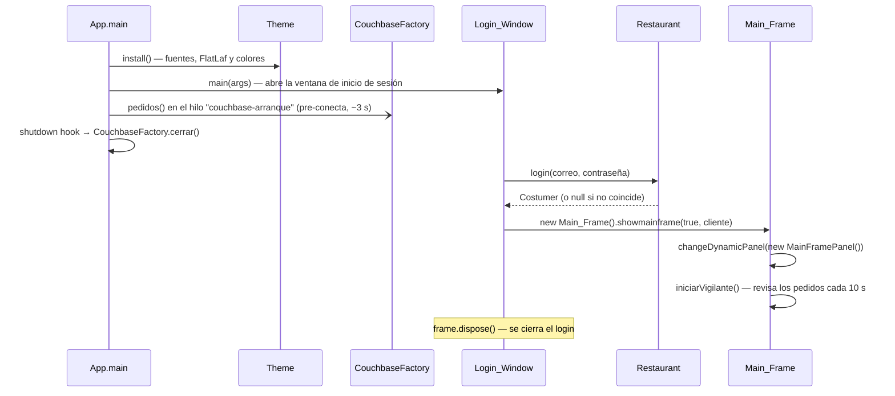
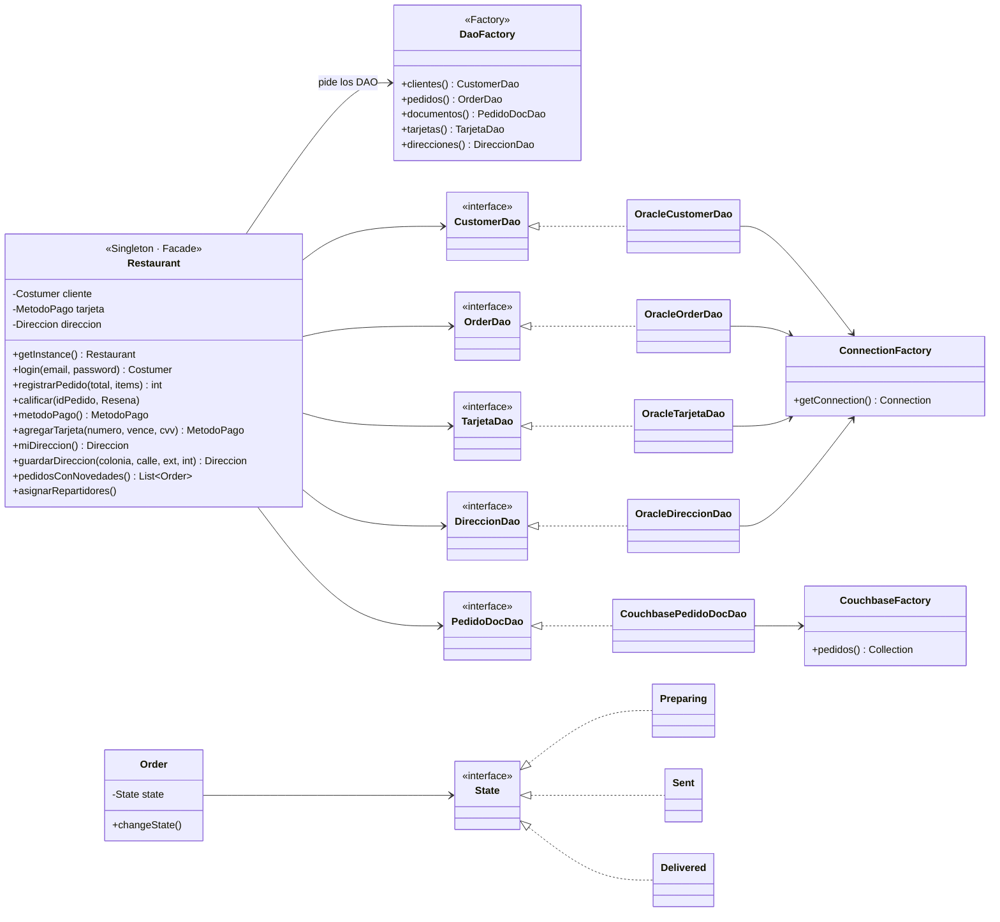
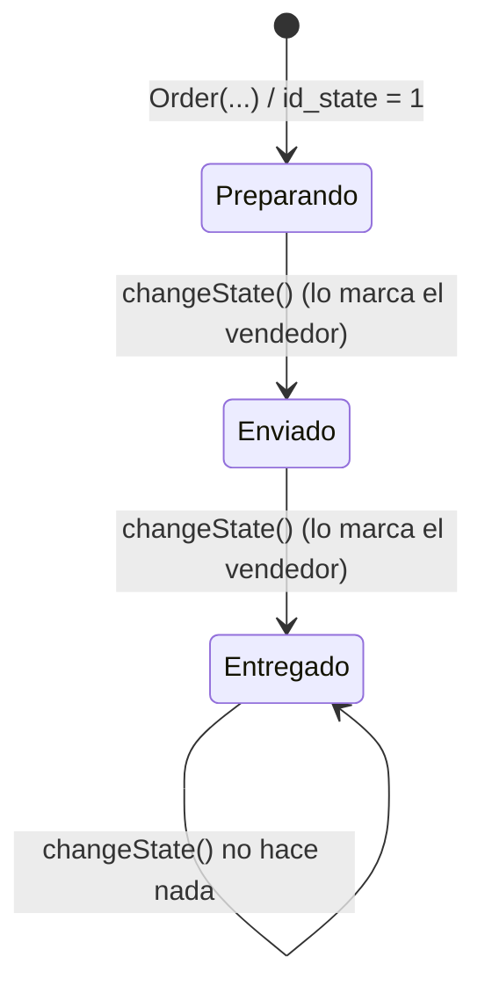
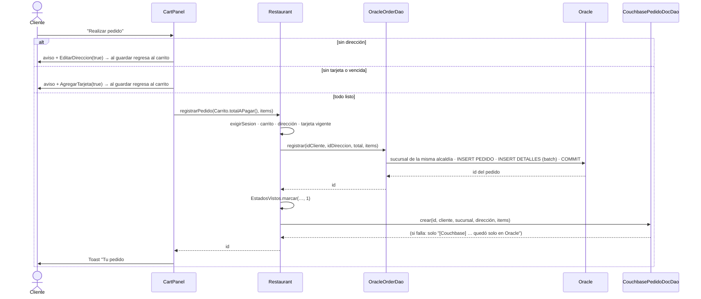
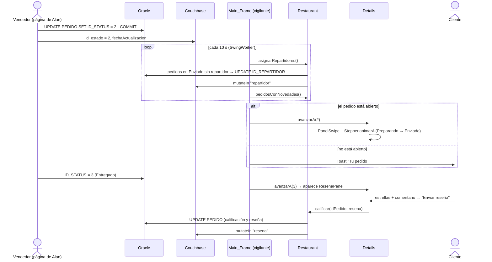

# Referencia técnica · Le Cartoon Gourmet

Documentación clase por clase del código: qué hace cada clase o interfaz, sus constructores y sus métodos públicos, y cómo se conectan entre sí.

> Para la visión general (capturas, instalación y configuración) ve al [README](../README.md).
> Convención: en las tablas, **`static`** indica método de clase. Los métodos privados solo se mencionan cuando explican cómo funciona algo.

**Ramas del repositorio**

| Rama | Con qué usuario entra la app a Oracle | Para qué |
|---|---|---|
| `data` | `CIB500_05` (dueño de las tablas, el esquema de Alan) | Versión estable. |
| `Client_data` | `CIB500_14` (cuenta **cliente**, con los permisos de la matriz de seguridad) | La app se comporta como cliente real. El SQL de los DAOs es idéntico; solo cambia `ConnectionFactory` (ver [sección 3](#3-datos-oracle-couchbase-y-las-dos-ramas)). |

Este documento sirve para las dos ramas; donde algo solo aplica a `Client_data` se indica.

---

## Índice

1. [Cómo arranca la app](#1-cómo-arranca-la-app)
2. [Mapa de paquetes](#2-mapa-de-paquetes)
3. [Datos: Oracle, Couchbase y las dos ramas](#3-datos-oracle-couchbase-y-las-dos-ramas)
4. [Núcleo del negocio](#4-núcleo-del-negocio-restaurante_completolecartoon_original)
5. [Patrón State: estados del pedido](#5-patrón-state-estados-del-pedido)
6. [Catálogo: `Dishes` y `Franchises`](#6-catálogo-dishes-y-franchises)
7. [Persistencia: `persistence`](#7-persistencia-persistence)
8. [Pantallas principales](#8-pantallas-principales)
9. [Seguimiento y reseñas: `OrderDetails`](#9-seguimiento-y-reseñas-orderdetails)
10. [Perfil: `ProfileScreens`](#10-perfil-profilescreens)
11. [Componentes de interfaz: `ui` y `ui.theme`](#11-componentes-de-interfaz-ui-y-uitheme)
12. [Flujos completos paso a paso](#12-flujos-completos-paso-a-paso)
13. [Manejo de errores](#13-manejo-de-errores)
14. [Cómo extender el proyecto](#14-cómo-extender-el-proyecto)
15. [Mejoras conocidas](#15-mejoras-conocidas)

---

## 1. Cómo arranca la app



1. **`App.main`** llama a `Theme.install()` **una sola vez**, antes de crear cualquier ventana. Así todos los componentes de Swing nacen ya con el tema.
2. Abre **`Login_Window`** y, **en otro hilo**, conecta a Couchbase Capella: la primera conexión tarda unos 3 s y así ocurre mientras el usuario escribe su correo. Si falla, solo se imprime `[Couchbase] …` y la app sigue con Oracle.
3. Registra un **shutdown hook** que cierra el `Cluster` de Couchbase al salir (también con `System.exit`).
4. Si el login sale bien, `Restaurant` guarda al cliente como **sesión**, se crea **`Main_Frame`** y se cierra el login.
5. `Main_Frame` tiene un **header fijo** y un **panel dinámico**: cada pantalla es un `JPanel` que se coloca ahí con `Main_Frame.changeDynamicPanel(panel)`. Al crearse arranca el **vigilante** (ver [sección 8](#8-pantallas-principales)).

---

## 2. Mapa de paquetes

| Paquete | Contenido | Depende de |
|---|---|---|
| `Restaurante_Completo.LeCartoon_Original` | Punto de entrada, modelo (`Costumer`, `Order`, `Resena`, `MetodoPago`, `Direccion`, `ZonaCobertura`, `Repartidor`…), reglas (`Restaurant`, `Carrito`, `EstadosVistos`), pantallas principales y botones | `persistence`, `ui`, `Dishes`, `Franchises` |
| `Dishes` | Clase base `Dishes` y 28 platillos | — |
| `Franchises` | Clase base `Franchises` y 5 franquicias | — |
| `persistence` | Conexión a Oracle, fábrica de DAO, interfaces DAO, excepción y pruebas de humo | modelo |
| `persistence.oracle` | DAOs para Oracle 19c (esquema de Alan) | `persistence` |
| `persistence.couchbase` | Conexión a Couchbase Capella y DAO del documento del pedido | `persistence`, SDK de Couchbase |
| `OrderDetails` | Pantalla de seguimiento, *stepper*, estrellas y reseña | núcleo, `ui`, `ui.theme` |
| `ProfileScreens` | Perfil y sus secciones (datos, pago, dirección, historial) | núcleo, `ui.theme` |
| `ui` | `Toast` (avisos flotantes) y `PanelSwipe` (animación) | `ui.theme` |
| `ui.theme` | Tema y componentes visuales reutilizables | FlatLaf |



**Patrones de diseño en el código**

| Patrón | Dónde | Para qué |
|---|---|---|
| **Singleton** | `Restaurant` | Una sola sesión y un solo punto de acceso a los datos. |
| **Facade** | `Restaurant` | Las pantallas no conocen DAOs, SQL ni Couchbase: llaman a `Restaurant` y él coordina (Oracle primero, Couchbase después). |
| **Factory** | `DaoFactory`, fábricas de `Buttons` | Un solo lugar decide qué implementación se usa. |
| **DAO** | `persistence.*Dao` | Aísla el SQL y el SDK de Couchbase detrás de interfaces. |
| **State** | `Order` + `Preparing` / `Sent` / `Delivered` | Color, GIF, mensaje y siguiente estado sin `if`. |
| **Extended Reference / Embedding / Schema Versioning** | Documento `pedido::<id>` en Couchbase | Ver [sección 7](#7-persistencia-persistence). |

---

## 3. Datos: Oracle, Couchbase y las dos ramas

**Oracle 19c (Prometeo) es la fuente de verdad.** Clientes, direcciones, tarjetas, pedidos, renglones, reseñas y repartidores viven ahí, en el esquema de Alan (`CIB500_05`).

**Couchbase Capella guarda una copia del pedido** como documento (`ProyectoFinal.lecartoon.pedido`, llave `pedido::<id de Oracle>`), pensada para la página web de vendedores de Alan.

**Regla de escritura: Oracle primero, Couchbase después.** `Restaurant` escribe en Oracle; solo si salió bien copia a Couchbase. Si Couchbase falla, se imprime `[Couchbase] … quedó solo en Oracle` y la operación **no** se cancela: el cliente nunca pierde un pedido porque la base NoSQL no respondió.

| Operación | Oracle | Couchbase |
|---|---|---|
| Hacer pedido | `INSERT PEDIDO` + `DETALLES_PEDIDO` (transacción) | `insert` del documento completo |
| Reseñar | `UPDATE PEDIDO` (calificación y reseña) | `mutateIn`: `resena` y `fechaActualizacion` |
| Asignar repartidor | `UPDATE PEDIDO SET ID_REPARTIDOR` | `mutateIn`: `repartidor` y `fechaActualizacion` |
| Avanzar estado | Lo hace la **página del vendedor** | Lo hace la **página del vendedor** |

**Rama `Client_data`: la app entra como cliente**

En `Client_data` la app se conecta con `CIB500_14`, la cuenta **cliente** de la matriz de seguridad. Las tablas siguen siendo de `CIB500_05`. Para no reescribir el SQL, `ConnectionFactory` ejecuta al abrir cada conexión:

```sql
ALTER SESSION SET CURRENT_SCHEMA = CIB500_05
```

`CURRENT_SCHEMA` solo cambia **dónde busca Oracle los nombres sin prefijo** (`pedido` → `CIB500_05.pedido`); los **permisos** se siguen revisando como `CIB500_14`. Todo lo que hace la app está cubierto por los `GRANT` del script de seguridad:

| Tablas | Uso en la app | Permiso de `CIB500_14` |
|---|---|---|
| `cliente`, `persona`, `telefono` | login, registro, perfil | SELECT, INSERT, UPDATE |
| `pedido` | leer, crear, reseña, asignar repartidor | SELECT, INSERT, UPDATE |
| `detalles_pedido` | leer, crear | SELECT, INSERT |
| `tarjeta_cliente` | leer, agregar | SELECT, INSERT, UPDATE |
| `calle`, `direccion`, `persona_direccion` | guardar dirección | SELECT, INSERT, UPDATE, DELETE |
| `pais` … `colonia`, `platillo`, `sucursal`, `repartidor` | solo lectura | SELECT |

Los *triggers* (autoincremento y auditoría `_H`) se ejecutan con los permisos de su dueño, así que el cliente no necesita nada sobre secuencias ni tablas de histórico. Una operación sin permiso (por ejemplo `DELETE FROM pedido`) responde **ORA-01031**.

---

## 4. Núcleo del negocio (`Restaurante_Completo.LeCartoon_Original`)

### `App`

Clase con el `main` de la aplicación.

| Método | Qué hace |
|---|---|
| **`static`** `main(String[] args)` | `Theme.install()`, abre `Login_Window.main(args)`, pre-conecta Couchbase en el hilo `couchbase-arranque` y registra el *shutdown hook* que lo cierra. |

---

### `Restaurant` · *Singleton + Facade*

`public final class`. Es el **único punto de entrada** de las pantallas a los datos y a las reglas de negocio. Guarda la sesión, coordina Oracle y Couchbase y delega en los DAO.

**Cómo funciona el Singleton:** `private static final Restaurant INSTANCIA = new Restaurant();` crea la instancia al cargar la clase (*eager*). El constructor es `private`, así que nadie más puede hacer `new Restaurant()`.

**Campos**

| Campo | Tipo | Para qué |
|---|---|---|
| `clientes`, `pedidos`, `documentos`, `tarjetas`, `direcciones` | `CustomerDao`, `OrderDao`, `PedidoDocDao`, `TarjetaDao`, `DireccionDao` | Se obtienen de `DaoFactory` al crear la instancia. |
| `cliente` | `Costumer` | Sesión actual; `null` si nadie ha iniciado sesión. |
| `tarjeta` + `tarjetaCargada` | `MetodoPago`, `boolean` | **Caché por sesión** de la tarjeta (ver `metodoPago()`). |
| `direccion` + `direccionCargada` | `Direccion`, `boolean` | **Caché por sesión** de la dirección (ver `miDireccion()`). |

**Sesión y perfil**

| Método | Qué hace |
|---|---|
| **`static`** `getInstance()` | Regresa la única instancia. |
| `login(String email, String password)` | Pide el cliente al DAO. Si existe, lo deja como sesión y **olvida la caché** del cliente anterior; si no, regresa `null`. |
| `registrar(Costumer nuevo)` | Inserta al cliente, le asigna el `id` que generó la base de datos (`setId`) y lo deja como sesión. |
| `cerrarSesion()` | Pone la sesión en `null` y olvida la caché de tarjeta y dirección. |
| `getCliente()` | Cliente con sesión iniciada. |
| `actualizarPerfil(Costumer c)` | Guarda nombre, apellido y teléfono. |

**Pedidos y reseñas**

| Método | Qué hace |
|---|---|
| `misPedidos()` | Pedidos del cliente en sesión, del más nuevo al más viejo. **Exige sesión**. |
| `detallesDe(int idPedido)` | Renglones del pedido (`OrderDetails`). |
| `registrarPedido(double total, List<ItemPedido> items)` | **Reglas:** exige sesión, carrito con algo (`IllegalArgumentException`), **dirección de entrega** y **tarjeta vigente** (`IllegalStateException` si falta alguna). Luego: 1) Oracle registra el pedido en una transacción; 2) `EstadosVistos` lo marca visto en "Preparando"; 3) crea el documento en Couchbase con la dirección. Regresa el id del pedido. |
| `resenaDe(int idPedido)` | Reseña guardada del pedido, o `null` si todavía no lo califican. |
| `calificar(int idPedido, Resena resena)` | **Exige sesión.** 1) Oracle (solo si está entregado y sin reseña); 2) Couchbase. |
| `cambiarEstado(Order pedido)` | Guarda `pedido.getId_state()` en Oracle. Ya no lo usa ninguna pantalla (el estado lo avanza el vendedor); se conserva para pruebas. |

**Método de pago**

| Método | Qué hace |
|---|---|
| `metodoPago()` | Tarjeta más reciente del cliente o `null`. Pregunta a Oracle **una sola vez por sesión**: el carrito se reconstruye en cada +/− y no conviene ir a Prometeo en cada clic. |
| `agregarTarjeta(String numero, YearMonth vence, String cvv)` | Valida (Luhn, no vencida, CVV de 3–4 dígitos; si no, `IllegalArgumentException`), la guarda en Oracle y la deja como la tarjeta de la sesión. |

**Dirección de entrega**

| Método | Qué hace |
|---|---|
| `miDireccion()` | Dirección activa del cliente o `null`. Misma caché por sesión que la tarjeta. |
| `zonaDe(String cp)` | Municipio, ciudad y colonias de un CP de la **zona de cobertura**; `null` si no son 5 dígitos (ni pregunta a Oracle) o si no entregamos ahí. |
| `guardarDireccion(ZonaCobertura.Colonia colonia, String calle, String numExterior, String numInterior)` | Limpia espacios, valida (colonia elegida, calle ≤ 100, número exterior ≤ 20; si no, `IllegalArgumentException`). **Si es la misma dirección que ya tenía, no toca Oracle.** Si cambió, guarda una dirección nueva y la vuelve a leer de Oracle. |

**Seguimiento** (los usa el vigilante de `Main_Frame` desde otro hilo)

| Método | Qué hace |
|---|---|
| `pedidosConNovedades()` | Pedidos cuyo estado en Oracle es mayor que el último que el cliente vio en esta computadora (`EstadosVistos`). |
| `asignarRepartidores()` | **Simula al vendedor:** a los pedidos del cliente en Enviado o Entregado sin repartidor, Oracle les asigna uno de su sucursal; después cada asignación se copia a Couchbase. Sin sesión, no hace nada. |
| `estadoVisto(Order)` / `marcarVisto(int idPedido, int estado)` | Lee o anota en `EstadosVistos`. |
| *privado* `exigirSesion()` | Lanza `IllegalStateException` si no hay cliente. |

---

### `Costumer`

Modelo del cliente. *(El nombre conserva la ortografía original del proyecto.)*

| Constructor | Cuándo se usa |
|---|---|
| `Costumer(String name, String lastName, String phone, String email, String password, String address)` | Cliente **nuevo**, antes de guardarlo. Su `id` queda en `-1`. |
| `Costumer(int id, String name, String lastName, String phone, String email, String password, String address)` | Cliente **leído de la base de datos**, ya con su `id`. |

Métodos: *getters* y *setters* de `id`, `name`, `lastName`, `phone`, `email`, `password`; `getAddress()` / `setAddress1(String)`; `toString()`.

> `address` es un campo heredado del diseño original y hoy vale `" "`. **La dirección de entrega real vive en Oracle** y se maneja con `Direccion` (ver más abajo) a través de `Restaurant.miDireccion()`.

---

### `Carrito` y `Carrito.ItemPedido`

`Carrito` guarda el pedido en curso en una lista **`static`**: es un solo carrito para toda la app. También concentra las **reglas de cobro**.

**`Carrito.ItemPedido`** (clase anidada `static`): un platillo y su cantidad.

| Miembro | Qué hace |
|---|---|
| `ItemPedido(Dishes platillo, int cantidad)` | Constructor. |
| `getPlatillo()` / `setPlatillo(Dishes)` | Platillo del renglón. |
| `getCantidad()` / `setCantidad(int)` | Unidades. |

**Constantes**

| Constante | Valor | Significado |
|---|---|---|
| `TASA_IVA` | `0.16` | IVA en México. |
| `ENVIO` | `35.00` | Costo fijo de envío en MXN. |

**Métodos** (todos `static`)

| Método | Qué hace |
|---|---|
| `agregarAlCarrito(Dishes platillo, int cantidad)` | Ignora cantidades ≤ 0. Si el platillo ya está, **suma** la cantidad; si no, agrega un renglón. |
| `quitar(int dishId)` | Elimina el renglón de ese platillo. |
| `cambiarCantidad(int dishId, int nuevaCantidad)` | Cambia la cantidad. Si llega a 0 o menos, **quita** el renglón. |
| `vaciar()` | Borra todo. |
| `estaVacio()` | `true` si no hay renglones. |
| `totalUnidades()` | Suma de cantidades; es el número de "Carrito (n)". |
| `total()` | Σ precio × cantidad, sin redondear. |
| `importePlatillos()` | `total()` redondeado a centavos. |
| `subtotal()` | Importe **sin IVA**: `total / 1.16`. Los precios del menú ya incluyen IVA. |
| `iva()` | `importePlatillos() − subtotal()`. Se calcula por diferencia para que siempre cuadre al centavo. |
| `envio()` | `35.00` si hay algo en el carrito; `0` si está vacío. |
| `totalAPagar()` | `importePlatillos() + envio()`. **Es lo que el cliente paga.** Oracle no lo guarda: `OracleOrderDao.pedidosDe` lo recalcula igual (platillos + envío). |
| `getPedidos()` | La lista de renglones. |

---

### `Order`

Pedido ya registrado. Contiene un objeto `State` que cambia según la etapa (ver [sección 5](#5-patrón-state-estados-del-pedido)).

| Campo | Significado |
|---|---|
| `id` | Id del pedido (`-1` si todavía no se guarda). |
| `id_costumer` | Id del cliente. |
| `totalPrice` | Total cobrado. |
| `id_state` | `1` = Preparando, `2` = Enviado, `3` = Entregado (así se guarda en la base de datos). |
| `state` | Objeto `State` que corresponde a `id_state`. |

| Constructor | Cuándo se usa |
|---|---|
| `Order(int id_costumer, double totalPrice)` | Pedido nuevo: `id = -1`, `id_state = 1` y estado `Preparing`. |
| `Order(int id, int id_costumer, double totalPrice, int id_state)` | Pedido leído de la base de datos: crea `Preparing`, `Sent` o `Delivered` según `id_state`. |

| Método | Qué hace |
|---|---|
| *getters/setters* de `id`, `id_costumer`, `totalPrice`, `id_state`, `state` | — |
| `changeState()` | Delega en el estado actual, que decide cuál sigue. |
| `actualState()`, `message()`, `getColor()`, `getHover()`, `getImage()` | Delegan en el estado actual: nombre, mensaje, color y GIF. |
| `preparing()`, `sent()`, `delivered()` | Delegan en el estado (hoy solo imprimen en consola). |
| `toString()` | Texto de depuración. |

---

### `OrderDetails`

Un renglón de un pedido **ya guardado**, tal como lo regresa la base de datos con `JOIN` a `PLATILLO`.

| Miembro | Qué hace |
|---|---|
| `OrderDetails(int idOrder, String dish, int quantity)` | `dish` es el **nombre** del platillo, no su id. |
| *getters/setters* de `idOrder`, `dish`, `quantity`; `toString()` | — |

---

### `Resena`

Reseña de un pedido entregado. Es **inmutable**: todos sus campos son `final` y no tiene *setters*.

| Miembro | Qué hace |
|---|---|
| `static final int MAX_COMENTARIO = 300` | Largo máximo del comentario: igual que `PEDIDO.RESENA`, que es `VARCHAR2(300 CHAR)`. |
| `Resena(int estrellas, String comentario, LocalDateTime fecha)` | **Valida:** las estrellas deben ir de 1 a 5 y el comentario no puede pasar de 300 caracteres; si no, lanza `IllegalArgumentException`. El comentario se recorta (`trim`) y un `null` se vuelve `""`. |
| `getEstrellas()` | `int` de 1 a 5. |
| `getComentario()` | Nunca regresa `null`. |
| `getFecha()` | Momento en que se envió. Al leerla de Oracle es `PEDIDO.FECHA_ACTUALIZACION`; puede ser `null` en las reseñas de los datos semilla. |

---

### `MetodoPago`

Tarjeta guardada del cliente **ya enmascarada**: la app nunca tiene en memoria el número completo ni el CVV, solo la marca y los últimos 4 dígitos. Es **inmutable**.

| Miembro | Qué hace |
|---|---|
| `MetodoPago(int id, String primerDigito, String ultimos4, YearMonth vence)` | La marca sale del primer dígito: 4 = VISA, 5 o 2 = MASTERCARD, 3 = AMEX; otro = TARJETA. |
| `getId()`, `getMarca()`, `getUltimos4()`, `getVence()` | Lectura. |
| `enmascarado()` / `corto()` / `venceTexto()` | `"•••• •••• •••• 1111"`, `"VISA •••• 1111"`, `"05/29"`. |
| `vencida()` | `true` si su mes ya pasó: `10/26` sirve hasta el 31 de octubre de 2026. |
| **`static`** `soloDigitos(String)` | Quita espacios y guiones. |
| **`static`** `numeroValido(String)` | 13–19 dígitos y que pase el **algoritmo de Luhn** (detecta errores de dedo). |
| **`static`** `cvvValido(String)` | 3 o 4 dígitos. |
| **`static`** `leerVence(String)` | `"05/29"` o `"0529"` → `YearMonth`; `null` si no tiene ese formato. |

### `Direccion`

Dirección de entrega completa: los nombres de toda la cadena del catálogo (`pais → estado → ciudad → municipio → codigo_postal → colonia → calle`) más los números de `DIRECCION`.

| Miembro | Qué hace |
|---|---|
| `Direccion(pais, estado, ciudad, municipio, cp, colonia, calle, numexterior, numinterior)` | Sin id (constructor original). |
| `Direccion(int id, …mismos campos…)` | Con el `ID_DIRECCION` de Oracle. |
| `getId()` y *getters/setters* de cada campo | — |
| `calleYNumero()` | `"Insurgentes Sur 300 int. B"` (el interior solo si hay). |
| `texto()` | Dirección completa en una línea, para el perfil y el carrito. |

### `ZonaCobertura` · *record*

Lo que la app sabe de un código postal de la zona de cobertura. Es un **`record`** (Java 16+): una clase inmutable cuyo constructor, *getters* (`zona.municipio()`), `equals` y `toString` los escribe el compilador.

| Miembro | Qué hace |
|---|---|
| `ZonaCobertura(cp, municipio, ciudad, estado, pais, List<Colonia> colonias)` | — |
| `record Colonia(int id, String nombre)` | Una colonia del catálogo. Su `toString()` es el nombre, que es lo que muestra el `JComboBox`. |
| `lugar()` | `"Benito Juárez, CDMX"`. |
| `colonia(String nombre)` | La colonia con ese nombre (sin importar mayúsculas) o `null`. Sirve al editar una dirección. |

### `Repartidor` · *record*

`record Repartidor(int id, String nombre, String telefono)`. Es lo mínimo que se copia al documento de Couchbase cuando se asigna (patrón *Extended Reference*, igual que el cliente).

### `EstadosVistos`

Clase *package-private* (solo la usa `Restaurant`). Recuerda, **en esta computadora**, el último estado que el cliente vio de cada pedido, para saber si "avanzó" desde la última vez.

Usa `java.util.prefs.Preferences`: un almacén clave → valor de Java que en Windows vive en el registro (`HKEY_CURRENT_USER\Software\JavaSoft\Prefs\lecartoon\estados-vistos`) y sobrevive a cerrar la app. No toca Oracle ni Couchbase. Clave: `"idCliente.idPedido"`; valor: 1, 2 o 3.

| Método `static` | Qué hace |
|---|---|
| `visto(idCliente, idPedido, estadoActual)` | Último estado visto. Si nunca se vio aquí, o lo guardado es mayor que el actual (la base se recreó), toma el actual como visto: así no se animan de golpe todos los pedidos viejos. |
| `marcar(idCliente, idPedido, estado)` | Anota el estado visto. |

Ambos son `synchronized` porque los llama el vigilante desde otro hilo.

---

## 5. Patrón State: estados del pedido



### Interfaz `State`

| Método | Qué debe regresar o hacer |
|---|---|
| `actualState()` | Nombre visible: `"Preparando"`, `"Enviado"` o `"Entregado"`. |
| `message()` | Mensaje para el cliente. |
| `getColor()` / `getHover()` | Color del estado y su versión para *hover*. |
| `getImage()` | Ruta del GIF del estado. |
| `changeState()` | Cambia el estado del `Order` al siguiente. |
| `preparing()`, `sent()`, `delivered()` | Transiciones heredadas del diseño original; hoy solo imprimen en consola. `Preparing.sent()` sí cambia a `Sent`. |

### Implementaciones

| Clase | `actualState()` | Color | GIF | `changeState()` |
|---|---|---|---|---|
| `Preparing` | Preparando | Terracota `#C65D3B` | `preparing1.gif` | → `new Sent(order)` |
| `Sent` | Enviado | Negro `#1B1B1B` | `sent1.gif` | → `new Delivered(order)` |
| `Delivered` | Entregado | Salvia `#99A88C` | `delivered1.gif` | No cambia (es el estado final). |

Las tres tienen constructor `(Order order)`, guardan la referencia al pedido para poder cambiar su estado y ofrecen `getOrder/setOrder` y `setColor`.

**Quién avanza el estado:** el **vendedor**, desde la página web de Alan (escribe en Oracle y en Couchbase). La app del cliente solo **detecta** el cambio y llama a `changeState()` para animarlo (ver [sección 9](#9-seguimiento-y-reseñas-orderdetails)).

**Por qué State:** la pantalla de seguimiento nunca pregunta "¿en qué estado está?" con `if`. Le pide al pedido su color, su GIF y su mensaje (`order.getColor()`…), y cada estado sabe los suyos. Agregar un estado nuevo, por ejemplo "Cancelado", es una clase más, no un `if` más en cada pantalla.

---

## 6. Catálogo: `Dishes` y `Franchises`

### `Dishes.Dishes` (clase base)

| Miembro | Qué hace |
|---|---|
| `Dishes(String name, double price, String description, int id, String image)` | Constructor. `image` es la ruta del recurso, por ejemplo `/DishesP/Dish3.png`. |
| `getName()`, `getPrice()`, `getDescription()`, `getId()`, `getImage()` | Lectura de los campos (`protected`). |

Cada platillo es una subclase con un constructor sin parámetros que llama a `super(...)`. Por ejemplo, `new Burrito()`. **El `id` coincide con `PLATILLO.ID_PLATILLO`** en Oracle (1–28).

| Id | Clase | Nombre | Precio | Franquicia |
|---|---|---|---|---|
| 1 | `Magnificarne` | Magnificarne | $549.49 | Un Show Más |
| 2 | `Sandwich_M` | Sándwich de la Muerte | $229.49 | Un Show Más |
| 3 | `Burrito` | Burrito Multicarne | $1,349.99 | Un Show Más |
| 4 | `Extrahuevordinario` | Reto Extrahuevordinario | $349.99 | Un Show Más |
| 5 | `Radicola` | Radicola | $74.99 | Un Show Más |
| 6 | `Hotcakes` | Hotcakes con tocino | $169.99 | Hora de Aventura |
| 7 | `Sandwich_Perfecto` | Sándwich Perfecto de Jake | $599.99 | Hora de Aventura |
| 8 | `Pastel_Manzana` | Pastel de Manzana | $389.99 | Hora de Aventura |
| 9 | `Super_Porp` | Refresco Super Porp | $49.99 | Hora de Aventura |
| 10 | `Costiburguer` | Costiburguer | $179.99 | Los Simpson |
| 11 | `Tapa_Arterias` | Tapa Arterias | $279.99 | Los Simpson |
| 12 | `Rosquilla_Rosa` | Rosquilla Rosa | $89.99 | Los Simpson |
| 13 | `Cerveza_Duff` | Cerveza Duff | $69.99 | Los Simpson |
| 14 | `Squishee` | Squishee | $79.99 | Los Simpson |
| 15 | `Ratatouille` | Ratatouille | $185.59 | Disney |
| 16 | `Empanadas` | Empanadas de espinaca de Kronk | $89.99 | Disney |
| 17 | `Buñuelos` | Buñuelos | $79.99 | Disney |
| 18 | `Jugo_Mabel` | Jugo Mabel | $99.99 | Disney |
| 19 | `Cangreburguer` | Cangreburguer | $149.99 | Bob Esponja |
| 20 | `Colorburguer` | Colorburguer | $169.99 | Bob Esponja |
| 21 | `Pizza_Don_Cangrejo` | Pizza de Don Cangrejo | $199.99 | Bob Esponja |
| 22 | `Limonada` | Limonada de Calamar | $54.99 | Bob Esponja |
| 23 | `Refresco_Algas` | Refresco de Algas | $54.99 | Bob Esponja |
| 24 | `ComboParque` | Combo Especial del Parque | $1,699.99 | Un Show Más |
| 25 | `ComboOoo` | Combo Tierras de Ooo | $779.99 | Hora de Aventura |
| 26 | `ComboSpringfield` | Combo Springfield Clásico | $399.99 | Los Simpson |
| 27 | `ComboPelicula` | Combo Gourmet de Película | $339.99 | Disney (no aparece en el inicio) |
| 28 | `ComboBikini` | Combo Fondo de Bikini | $299.99 | Bob Esponja |

### `Franchises.Franchises` (clase base)

| Miembro | Qué hace |
|---|---|
| `Franchises(String name, String image, String logo, String color)` | `image` es la portada, `logo` el ícono de 60×60 y `color` el fondo en hex (`"#9EF2F7"`). |
| `getName()`, `getImage()`, `getLogo()`, `getColor()` | Lectura. |

| Subclase | Nombre | Color de fondo |
|---|---|---|
| `Regular` | Un Show Más | `#F3E5FF` |
| `Adventure` | Hora de Aventura | `#F1FFF0` |
| `Simpson` | Los Simpson | `#F9FCBD` |
| `Disney` | Disney | `#AFC7F7` |
| `Sponge` | Bob Esponja | `#9EF2F7` |

> Qué platillos tiene cada franquicia se decide **en un solo lugar**: `Main_Frame.platillosDe(clave)`. Cuando el catálogo venga de la base de datos (`DishDao`), solo cambia ese método.

---

## 7. Persistencia (`persistence`)

### `ConnectionFactory`

`public final class` con solo métodos estáticos. Abre una **conexión nueva por operación**: cada DAO la abre con *try-with-resources* y se cierra sola al terminar.

| Miembro | Qué hace |
|---|---|
| bloque `static { … }` | Al cargar la clase, lee `db.properties` y resuelve `URL`, `USER`, `PASSWORD` y, en `Client_data`, `SCHEMA`. Si `db.url` no empieza con `jdbc:oracle:`, lanza `IllegalStateException`: la app solo trabaja con Oracle. |
| *privado* `leer(Properties, String clave)` | Busca la clave en orden: **`-Dclave`** → variable de entorno **`LECARTOON_CLAVE`** (por ejemplo `db.user` → `LECARTOON_DB_USER`) → `db.properties`. |
| **`static`** `getConnection()` | Abre la conexión con usuario y contraseña. Si no hay usuario, lanza `SQLException` pidiendo definir `LECARTOON_DB_USER` y `LECARTOON_DB_PASSWORD`. **En `Client_data`**, si `db.schema` tiene valor y no es el mismo usuario, ejecuta `ALTER SESSION SET CURRENT_SCHEMA = <esquema>`; si eso falla, cierra la conexión antes de lanzar el error. |
| **`static`** `describir()` | Regresa la URL. La usa `PruebaConexion`. |
| **`static`** `usuario()` / `esquema()` | *(Client_data)* Usuario con el que entra la app y esquema donde se buscan las tablas. |

**`db.properties`** solo tiene la URL de Prometeo (y en `Client_data`, `db.schema=CIB500_05`). El usuario y la contraseña **nunca** van en el repositorio, que es público.

En `Client_data`, el esquema va pegado dentro del `ALTER SESSION`, así que solo se acepta un nombre válido (`[A-Z][A-Z0-9_$#]*`). Un valor como `"CIB500_05; DROP TABLE pedido"` se rechaza al arrancar.

### `DaoFactory` · *Factory*

| Método | Qué hace |
|---|---|
| **`static`** `clientes()` | `OracleCustomerDao` |
| **`static`** `pedidos()` | `OracleOrderDao` |
| **`static`** `documentos()` | `CouchbasePedidoDocDao` |
| **`static`** `tarjetas()` | `OracleTarjetaDao` |
| **`static`** `direcciones()` | `OracleDireccionDao` |

Es el único lugar que conoce las clases concretas: `Restaurant` y las pantallas solo ven las interfaces.

### Interfaz `CustomerDao`

| Método | Contrato |
|---|---|
| `Costumer login(String email, String password)` | Cliente si coinciden correo y contraseña; `null` si no. |
| `int registrar(Costumer nuevo)` | Inserta y regresa el **id generado** por la base de datos. |
| `void actualizarPerfil(Costumer c)` | Actualiza nombre, apellido y teléfono por `id`. |

### Interfaz `OrderDao`

| Método | Contrato |
|---|---|
| `List<Order> pedidosDe(int idCliente)` | Pedidos del cliente, del más reciente al más viejo. **Lista vacía, nunca `null`.** |
| `List<OrderDetails> detallesDe(int idPedido)` | Renglones del pedido. |
| `void cambiarEstado(int idPedido, int estado)` | Guarda el nuevo estado (`ID_STATUS`). |
| `int registrar(int idCliente, int idDireccion, double total, List<ItemPedido> items)` | Inserta el pedido (con su dirección de entrega) y sus renglones **en una sola transacción** y regresa el id del pedido. |
| `Resena resenaDe(int idPedido)` | Reseña del pedido; `null` si todavía no lo califican. |
| `void calificar(int idPedido, Resena resena)` | Guarda la reseña. Solo pedidos entregados y solo una vez; si no se puede, lanza `DaoException`. |
| `int sucursalDePedido(int idPedido)` | Sucursal asignada (la usa el documento de Couchbase). |
| `Map<Integer, Repartidor> asignarRepartidores(int idCliente)` | A los pedidos del cliente en Enviado/Entregado sin repartidor les asigna uno de su sucursal. Regresa `id_pedido → repartidor` de los asignados en esa llamada. |

### Interfaz `TarjetaDao`

| Método | Contrato |
|---|---|
| `MetodoPago tarjetaDe(int idCliente)` | La tarjeta más reciente del cliente, o `null`. |
| `int registrar(int idCliente, String numero, YearMonth vence, String cvv)` | Guarda una tarjeta nueva y regresa su id. |

### Interfaz `DireccionDao`

| Método | Contrato |
|---|---|
| `Direccion direccionDe(int idCliente)` | La dirección activa del cliente, o `null`. |
| `ZonaCobertura zonaDe(String cp)` | Municipio, ciudad, estado y colonias de ese CP; `null` si no está en la zona de cobertura. |
| `int guardar(int idCliente, int idColonia, String calle, String numExterior, String numInterior)` | Guarda una dirección **nueva** y la deja como la única del cliente. La anterior no se borra: los pedidos viejos la siguen usando. |

### Interfaz `PedidoDocDao`

| Método | Contrato |
|---|---|
| `void crear(int idPedido, Costumer cliente, int idSucursal, Direccion entrega, List<ItemPedido> items)` | Crea el documento `pedido::<id>` con el id que dio Oracle. |
| `void calificar(int idPedido, Resena resena)` | Pone la reseña dentro del documento. |
| `void asignarRepartidor(int idPedido, Repartidor repartidor)` | Pone el repartidor dentro del documento. |

### `DaoException`

`extends RuntimeException` (*unchecked*). Constructor `DaoException(String mensaje, Throwable causa)`: el mensaje es para humanos y la causa conserva la `SQLException` o `CouchbaseException` original para depurar. Al ser *unchecked*, las interfaces DAO no se ensucian con `throws SQLException`, que es algo propio de JDBC.

### `persistence.oracle.OracleCustomerDao`

Un cliente de la app se reparte en tres tablas: `CLIENTE` (correo y contraseña), `PERSONA` (nombre y apellidos) y `TELEFONO`.

| Método | Cómo funciona |
|---|---|
| `login` | `CLIENTE JOIN PERSONA`, con el teléfono en una subconsulta `MIN(...)` para que siempre salga una sola fila. El `id` del `Costumer` es `ID_CLIENTE`. |
| `registrar` | Transacción: `INSERT PERSONA` → `INSERT CLIENTE` → `INSERT TELEFONO` (si lo dio). Cada id lo pone su secuencia + *trigger*, y Java lo recupera con `prepareStatement(sql, new String[] { "ID_PERSONA" })`. Si el correo ya existe (`ORA-00001`), lanza `DaoException("Ese correo ya está registrado")`. |
| `actualizarPerfil` | Transacción: `UPDATE PERSONA` y `UPDATE TELEFONO` (o `INSERT` si no tenía), llegando al `ID_PERSONA` con una subconsulta desde `ID_CLIENTE`. |
| *privados* `separarApellidos` / `juntarApellidos` | La app maneja un solo `lastName`; se parte en el primer espacio en `APELLIDOPATERNO` y `APELLIDOMATERNO`. |

Todas las consultas de todos los DAOs usan **`PreparedStatement` con `?`**: los valores nunca se concatenan al SQL, así que no hay riesgo de inyección SQL.

### `persistence.oracle.OracleOrderDao`

| Método | Cómo funciona |
|---|---|
| `pedidosDe` | `PEDIDO` del cliente, del más nuevo al más viejo. El total no está guardado: se calcula con `SUM(cantidad × precio)` de sus renglones + `Carrito.ENVIO`. |
| `detallesDe` | `DETALLES_PEDIDO JOIN PLATILLO` para traer el **nombre** del platillo en una sola consulta. |
| `cambiarEstado` | `UPDATE PEDIDO SET ID_STATUS = ?, FECHA_ACTUALIZACION = SYSDATE`. Al pasar a Enviado asigna un repartidor de la sucursal si no tenía. |
| `registrar` | `setAutoCommit(false)` → `sucursalPara(idDireccion)` → `insertarPedido` (con `ID_DIRECCION`) → `insertarDetalles` → `commit()`. Ante cualquier error hace **`rollback()`**: se guarda todo o nada. |
| *privado* `sucursalPara(Connection, idDireccion)` | **La sucursal de la misma alcaldía que la dirección de entrega.** Un `CASE` dentro del `ORDER BY` pone primero (0) las sucursales cuya alcaldía coincide y después (1) las demás; empate → menor id. Hay una sucursal por cada alcaldía de cobertura. |
| `asignarRepartidores` | 1) `SELECT` de los pedidos del cliente con `ID_STATUS >= 2` e `ID_REPARTIDOR IS NULL`; 2) para cada uno, un repartidor de su sucursal (`ORDER BY DBMS_RANDOM.VALUE FETCH FIRST 1 ROW ONLY`) con nombre y teléfono; 3) `UPDATE PEDIDO SET ID_REPARTIDOR = ? WHERE ID_PEDIDO = ? AND ID_REPARTIDOR IS NULL`. Ese `IS NULL` evita pisar un repartidor que ya haya puesto la página del vendedor. |
| `sucursalDePedido` | `SELECT ID_SUCURSAL FROM PEDIDO`. |
| `resenaDe` | `SELECT CALIFICACION, RESENA, FECHA_ACTUALIZACION FROM PEDIDO`. Si `CALIFICACION` es `NULL`, regresa `null`. |
| `calificar` | `UPDATE PEDIDO SET CALIFICACION = ?, RESENA = ?, FECHA_ACTUALIZACION = SYSDATE WHERE ID_PEDIDO = ? AND ID_STATUS = 3 AND CALIFICACION IS NULL`. Un comentario vacío se guarda como `NULL`. El *trigger* `TRG_AUD_PEDIDO` deja la reseña en `PEDIDO_H`. |
| *privado* `insertarDetalles(Connection, …)` | Un renglón por platillo con **`addBatch()` / `executeBatch()`**: todos se mandan juntos a la base de datos. |

Los métodos privados **reciben la misma `Connection`**: la transacción vive en la conexión, así que todos los `INSERT` deben usar la misma.

### `persistence.oracle.OracleTarjetaDao`

| Método | Cómo funciona |
|---|---|
| `tarjetaDe` | `SELECT … SUBSTR(NUM_TARJETA, 1, 1), SUBSTR(NUM_TARJETA, -4), EXPIRACION FROM TARJETA_CLIENTE WHERE ID_CLIENTE = ? ORDER BY ID_TARJETA_CLIENTE DESC FETCH FIRST 1 ROW ONLY`. El número se recorta **dentro de Oracle**: el número completo y el CVV nunca viajan a la app. `FETCH FIRST` se aplica **después** del `ORDER BY` (`ROWNUM` no). |
| `registrar` | `INSERT INTO TARJETA_CLIENTE (ID_CLIENTE, NUM_TARJETA, EXPIRACION, CVV)`. `EXPIRACION` se guarda como el día 1 del mes. El id lo pone el *trigger* `ID_TARJETA_CLIENTE_TRGG`. |

### `persistence.oracle.OracleDireccionDao`

La dirección está normalizada en 8 tablas (`pais → estado → ciudad → municipio → codigo_postal → colonia → calle → direccion`) y se liga al cliente por `PERSONA_DIRECCION` (vía `CLIENTE.ID_PERSONA`).

**Zona de cobertura** = las filas de `CODIGO_POSTAL` + `COLONIA` que carga el script. El cliente escribe su CP, elige su colonia y escribe calle y números.

| Método | Cómo funciona |
|---|---|
| `direccionDe` | `JOIN` de 9 tablas desde `CLIENTE` hasta `PAIS`; la más reciente (`ORDER BY ID_DIRECCION DESC FETCH FIRST 1 ROW ONLY`). |
| `zonaDe` | `CODIGO_POSTAL JOIN COLONIA JOIN MUNICIPIO … PAIS WHERE CODIGO = ?`: una fila por colonia. Sin filas = fuera de cobertura (`null`). |
| `guardar` | **Una transacción:** 1) `ID_PERSONA` del cliente; 2) **buscar o crear la calle** en esa colonia (`UPPER(TRIM(NOMBRE))`), así dos vecinos de "Insurgentes Sur" comparten la fila; 3) `INSERT DIRECCION`; 4) `DELETE` + `INSERT PERSONA_DIRECCION`: una sola dirección activa. La `DIRECCION` vieja se queda porque `PEDIDO.ID_DIRECCION` la sigue usando. El *trigger* de auditoría deja en `PERSONA_DIRECCION_H` un `BORRADO` y un `INSERT`. |

### `persistence.couchbase.CouchbaseFactory`

Conexión **única** a Couchbase Capella, a diferencia de Oracle (conexión por operación): conectar a Capella tarda segundos y `Cluster` es *thread-safe*.

| Método `static` | Qué hace |
|---|---|
| `pedidos()` | `synchronized`. La primera vez conecta (perfil `wan-development`) y espera hasta 20 s con `waitUntilReady`, para que un error se vea aquí y no después. Regresa la `Collection` de los pedidos. |
| `cerrar()` | Desconecta; lo llama el *shutdown hook* de `App`. |

Variables: `LECARTOON_CB_URL`, `LECARTOON_CB_USER`, `LECARTOON_CB_PASSWORD`, `LECARTOON_CB_BUCKET` (obligatorias), `LECARTOON_CB_SCOPE` y `LECARTOON_CB_COLLECTION` (si faltan, `_default`). En el proyecto: `ProyectoFinal` / `lecartoon` / `pedido`.

### `persistence.couchbase.CouchbasePedidoDocDao`

Documento `pedido::<id de Oracle>` con el formato de Alan (`version: 1`). Fechas como texto `"dd-MM-yyyy HH:mm:ss"`, igual que la página del vendedor.

```json
{
  "id_pedido": 42,
  "cliente":    { "id_cliente": 6, "nombre": "Laura Gómez Pérez", "telefono": "5545678901" },
  "repartidor": null,
  "id_sucursal": 6,
  "id_estado": 1,
  "direccion":  { "pais": "México", "estado": "Ciudad de México", "ciudad": "CDMX",
                  "municipio": "Venustiano Carranza", "cp": "15900", "colonia": "Jardín Balbuena",
                  "calle": "Sidar y Rovirosa", "numExterior": "310", "numInterior": null },
  "detalles":   [ { "id_platillo": 2, "nombre": "Sándwich de la Muerte", "cantidad": 2,
                    "precio": 229.49, "observaciones": null } ],
  "subtotal": 458.98,
  "fechaCreacion": "12-11-2026 08:23:51",
  "fechaActualizacion": null,
  "resena": { "calificacion": null, "comentarios": null },
  "version": 1
}
```

| Patrón NoSQL | Dónde |
|---|---|
| **Embedding** | `detalles` van dentro del pedido: se leen siempre juntos. |
| **Extended Reference** | Copia de `cliente`, `direccion` y `repartidor` (solo lo que muestra la página del vendedor). `precio` guarda el precio **de compra**. |
| **Computed** | `subtotal` ya calculado (sin envío). |
| **Schema Versioning** | `version: 1`. |

| Método | Cómo funciona |
|---|---|
| `crear` | `insert` (no `upsert`): si la llave ya existe falla con `DocumentExistsException`, señal de un choque de ids. |
| `calificar` | `mutateIn`: solo `resena` y `fechaActualizacion` (sub-documento, no reescribe el resto). |
| `asignarRepartidor` | `mutateIn`: solo `repartidor` (`id_repartidor`, `nombre`, `telefono`) y `fechaActualizacion`. El estado lo pone la página del vendedor. |

Para revisar los documentos: Capella → **Data Tools** → `SELECT * FROM ProyectoFinal.lecartoon.pedido USE KEYS "pedido::42";`

### Pruebas de humo (`main` independientes)

| Clase | Qué prueba |
|---|---|
| `PruebaConexion` | Conexión a Oracle con *timeout* de 10 s: tiempo, usuario, hora del servidor, versión y driver. En `Client_data` también muestra el **esquema** de las tablas y prueba la lectura de las 18 tablas que usa la app (OK o FALLA con su código ORA). |
| `PruebaCouchbase` | Conecta a Capella, escribe y lee el documento `prueba::conexion`. |
| `PruebaClientes` | Plantilla vacía. |

---

## 8. Pantallas principales

### `Main_Frame`: ventana principal

Ventana sin barra de Windows (*undecorated*) con **header** y **panel dinámico**. Casi todo es `static` para que cualquier pantalla pueda navegar sin tener una referencia a la ventana.

| Método | Qué hace |
|---|---|
| `Main_Frame()` | Crea la ventana: `maximizar()`, header, la pantalla de inicio y arranca el vigilante. |
| `showmainframe(boolean visible, Costumer c)` | Muestra u oculta la ventana. |
| **`static`** `changeDynamicPanel(JPanel panel)` | **Navegación:** reemplaza la pantalla actual, marca la pestaña que corresponde y actualiza "Carrito (n)". |
| **`static`** `irAMisPedidos()` | Abre el perfil directamente en el historial. |
| **`static`** `irADireccionDesdeCarrito()` | Abre el perfil en `EditarDireccion(true)`: al guardar regresa al carrito. |
| **`static`** `irATarjetaDesdeCarrito()` | Abre el perfil en `AgregarTarjeta(true)`: al guardar regresa al carrito. |
| **`static`** `actualizarCarrito()` | Escribe "Carrito (n)" con `Carrito.totalUnidades()`. |
| **`static`** `abrirCocina(String clave)` | Abre `FranchiseDetails` con la franquicia y sus platillos. Las claves son `"Regular"`, `"Adventure"`, `"Simpson"`, `"Disney"` y `"Sponge"`. |
| *privado* `crearHeader()` | Arma el header: marca, navegación y zona derecha. Arrastrarlo mueve la ventana (si no está maximizada); el doble clic alterna entre maximizada y normal. |
| *privado* `crearNavegacion()` | Pestañas Inicio · Cocinas ▼ · Mis pedidos · Mi perfil (`Buttons.nav`). |
| *privado* `crearMenuCocinas()` | `JPopupMenu` con las 5 franquicias y sus logos. |
| *privado* `crearZonaDerecha()` | Espacio de la dirección (vacío desde que se quitó "Entregar en"), botón del carrito y botones `—` / `×`. |
| *privado* `maximizar()` | Ocupa `getMaximumWindowBounds()`, el área de la pantalla **sin** la barra de tareas. |
| *privado* `crearFranquicia(clave)` / `platillosDe(clave)` | **El catálogo.** Usa un `switch` clásico con `return`: la versión `return switch … ->` tronaba con Eclipse (VerifyError). |
| *privado* `marcarSeccion(JPanel)` | Por el tipo de pantalla (`instanceof`) decide qué pestaña subrayar. |

**El vigilante** (detección de cambios de estado)

| Miembro | Qué hace |
|---|---|
| `CADA_MS = 10_000` | Cada cuánto revisa. |
| **`static`** `iniciarVigilante()` / `detenerVigilante()` | Arranca un `javax.swing.Timer` al crear la ventana; se detiene al cerrar sesión. |
| **`static`** `revisarPedidos()` | Si no hay otra revisión en curso, lanza un **`SwingWorker`**. En segundo plano: 1) `Restaurant.asignarRepartidores()` (si falla, sigue); 2) `Restaurant.pedidosConNovedades()`. De vuelta en el hilo de Swing, llama a `aplicarNovedades`. |
| *privado* `aplicarNovedades(List<Order>)` | Si el pedido cambiado está **abierto** en `Details`, lo anima con `avanzarA`. Si no, muestra un `Toast` ("Tu pedido #N ya va en camino", sin repetir avisos) y pone **"Mis pedidos (n)"** en el header. |

`SwingWorker` hace la consulta fuera del hilo de eventos para que la ventana no se congele mientras Oracle responde.

### `MainFramePanel`: inicio

| Miembro | Qué hace |
|---|---|
| `MainFramePanel()` | Saludo con el nombre del cliente, 3 promociones, 4 franquicias, 4 combos y la misión. Cada bloque es una `Grilla`. |
| *privado* `cocina(imagen, clave)` | `PromoCard` que llama a `Main_Frame.abrirCocina(clave)`. |
| *privado* `combo(imagen, franquicia, platillo)` | `PromoCard` que abre `OrderDetails_2` del combo. |

La promo "Duplica tu antojo" baja hasta la sección de combos (`scrollRectToVisible`); la de Springfield abre su combo.

### `FranchiseDetails`: cocina de una franquicia

| Miembro | Qué hace |
|---|---|
| `FranchiseDetails(Franchises f, ArrayList<Dishes> platillos, JPanel anterior)` | Botón "← Volver", portada de 300 px de alto, logo, nombre, chip "N PLATILLOS" y la cuadrícula de platillos. El fondo es el color de la franquicia. |
| *privado* `tarjetaPlatillo(f, platillo)` | `Tarjeta` con foto, nombre, precio y "Ver →". Toda la tarjeta es clicable (`hacerClicable`) y abre `OrderDetails_2` pasando **esta misma pantalla** como anterior, para que "Volver" regrese aquí. |
| **`static`** `colorDe(Franchises)` | Convierte el hex en `Color`; si el hex es inválido regresa blanco. |

### `OrderDetails_2`: detalle del platillo

| Miembro | Qué hace |
|---|---|
| `OrderDetails_2(Franchises f, Dishes platillo, JPanel anterior)` | Foto, chip "Origen de la serie", nombre, precio y descripción; abajo, una barra fija con total, − n + y "Añadir al carrito". |
| *privado* `crearBarraInferior(platillo)` | El botón de añadir llama a `Carrito.agregarAlCarrito`, luego a `Main_Frame.actualizarCarrito()` y muestra un `Toast.exito`. |
| *privado* `actualizarComponentes()` | Recalcula cantidad y total al usar − / +. La cantidad mínima es 1. |

### `CartPanel`: carrito

| Miembro | Qué hace |
|---|---|
| `CartPanel(ArrayList<ItemPedido> lista)` | Carrito vacío: tarjeta "Tu carrito está vacío" con "Explorar cocinas". Con platillos: lista a la izquierda y resumen a la derecha (subtotal, IVA, envío, total, **dirección real**, **tarjeta real** y **"Realizar pedido"**). |
| "Realizar pedido" | 1) Sin dirección → aviso y `Main_Frame.irADireccionDesdeCarrito()`. 2) Sin tarjeta o vencida → aviso y `Main_Frame.irATarjetaDesdeCarrito()`. 3) `Restaurant.registrarPedido(...)`, `Toast` "Tu pedido #id fue realizado", vacía el carrito y regresa al inicio. |
| *privado* `textoDireccion()` / `textoMetodoPago()` | La dirección (`Direccion.texto()`) y la tarjeta (`"VISA •••• 1111"`, con "(vencida)" si aplica), o qué hacer si faltan ("… la pedimos al confirmar"). Usan la caché de `Restaurant`. |
| *privado* `crearItemCard(item)` | Foto, nombre, primera línea de la descripción, − n + y Quitar. Muestra el importe y, si hay más de una unidad, el precio unitario. |
| *privado* `refrescar()` | Reconstruye la pantalla completa después de cada cambio. Es más simple y seguro que actualizar cada etiqueta por separado. |
| *privado* `dinero(double)` | Formato `$1,234.50` con `Locale es-MX`. |

### `Buttons`: botón con estilos · *Factory*

`extends JButton`. Tiene un `enum Estilo { CLASICO, ACCION, NAV, CONTROL, CHIP }` y **fábricas estáticas** para no repetir configuración:

| Fábrica | Estilo | Uso |
|---|---|---|
| `primario(texto)` | ACCION negro | Confirmar (Entrar, Guardar, Crear cuenta). |
| `acento(texto)` | ACCION terracota | **La** acción principal de la pantalla (solo una). |
| `secundario(texto)` | ACCION blanco | Alternativas (Volver, Editar perfil). |
| `peligro(texto)` | ACCION ladrillo, *hover* vino | Quitar, Vaciar, Cerrar sesión. |
| `estado(texto, color)` | ACCION del color dado | Botones que usan el color del estado. |
| `nav(texto, fondoBarra)` | NAV | Pestañas; `setSeleccionado(true)` pinta la barra terracota abajo. |
| `control(texto, fondoBarra, esCerrar)` | CONTROL | `—` y `×`; el *hover* de cerrar es ladrillo. |
| `chip(texto)` | CHIP | Dato que no se clica ("13 PEDIDOS"). |

El constructor público `Buttons(texto, arcW, arcH, fondo, hover)` da el estilo CLASICO original (redondeado). Se conserva por compatibilidad.

**Cómo se dibuja ACCION** (`pintarAccion`): 1) la sombra desplazada 6 px; 2) el rectángulo del borde; 3) la cara (gris si el botón está deshabilitado). Al presionarlo, el botón se dibuja **sobre** su sombra y parece que se hunde. Al sumar el `setBounds`, recuerda que **la sombra cuenta dentro del tamaño** del botón: añade +6 px.

Otros métodos: `setColorFondo(Color)` (en ACCION también ajusta el *hover* y el color del texto), `setColorBordeCustom`, `setColorHover` e `isSeleccionado/setSeleccionado`.

### `PromoCard`: tarjeta-imagen clicable

| Miembro | Qué hace |
|---|---|
| `PromoCard(String rutaImagen, int ancho, int alto)` | `ancho` y `alto` son el tamaño **preferido**; el layout puede cambiarlo. |
| `setInteractiva(boolean)` | `false` para imágenes decorativas: sin *hover*, sin mano y sin clic. |
| `addActionListener` / `removeActionListener` | Igual que en un botón, usando `EventListenerList`. |
| `paintComponent` | Sombra (terracota en *hover*), borde e imagen en modo *cover*. Al presionar, se hunde. |

### `Login_Window`, `Register_Window` y `Acceso`

`Acceso` es una clase *package-private* con las piezas que comparten las dos ventanas:

| Método `static` | Qué hace |
|---|---|
| `prepararVentana(JFrame)` | Ventana de 980×710 sin barra de Windows, centrada, con borde y arrastrable. |
| `panelIzquierdo(rutaGif, frase)` | GIF a todo el panel, escalado para cubrir y recortado al centro. Usa `SCALE_DEFAULT` para que **siga animado**. |
| `panelDerecho(frame, formulario)` | Logo, `—` / `×` y el formulario centrado. |
| `campo(placeholder, icono)` / `campoContraseña(placeholder)` | Campos con *placeholder* de FlatLaf (se dibuja, no es texto real) y botón para mostrar la contraseña. |
| `validarLlenos(JTextComponent...)` | Marca en rojo los campos vacíos (`JComponent.outline = "error"`) y regresa `true` si todos están llenos. |
| `marcarError(JTextComponent...)` | Marca campos con error. |

- **`Login_Window`:** `main(String[])` abre el login. Al dar "Entrar": valida los campos, llama a `Restaurant.login` y, si funciona, abre `Main_Frame`; si no, muestra "Correo o contraseña incorrectos". `Enter` equivale a dar clic en "Entrar" (`setDefaultButton`). Método `showloginframe(boolean)`.
- **`Register_Window`:** valida los 6 campos, crea un `Costumer`, llama a `Restaurant.registrar` y abre `Main_Frame`. Tiene el botón "← Ya tengo cuenta". Método `showregframe(boolean)`.

---

## 9. Seguimiento y reseñas (`OrderDetails`)

### `Details`: seguimiento del pedido

El cliente **ya no avanza su pedido**: lo avanza el vendedor desde su página. Cuando la app detecta el cambio (al abrir el pedido o con el vigilante), la tarjeta se **desliza** al estado nuevo.

| Miembro | Qué hace |
|---|---|
| `Details(ArrayList<OrderDetails> renglones, Order pedido)` | Si el pedido avanzó mientras el cliente no lo veía (`estadoVisto < estado real`), la pantalla **arranca en el estado visto** y 0.7 s después se desliza hasta el real. |
| `initialize()` | "← Mis pedidos", título, *badge* de estado, `Stepper`, tarjeta de estado envuelta en un `PanelSwipe` (GIF, hora estimada y mensaje), tarjeta de platillos con total y el espacio para la reseña. |
| `updateGraphics(Order)` | Repinta todo según el estado, sin animar. |
| `avanzarA(int nuevoEstado)` | Lleva la pantalla **paso por paso** hasta ese estado. Si ya va en camino o ya está ahí, no hace nada (los avisos repetidos se ignoran). |
| *privado* `siguientePaso()` | Un paso: `PanelSwipe.animar(…)` con el cambio `id_state + 1` → `order.changeState()` (patrón State) → `pintarEstado(order, true)`. Al llegar: marca el estado como visto, muestra un `Toast` y pide a `Main_Frame` que actualice "Mis pedidos (n)". |
| *privado* `pintarEstado(Order, boolean animarStepper)` | Color de la tarjeta, colores de texto (`Theme.textoSobre`), GIF (escalado con `SCALE_DEFAULT` para que siga animado), mensaje, *badge* y *stepper* (de golpe o con `animarA`). Si está entregado, muestra la reseña. |
| *privado* `mostrarResena(boolean entregado)` | Solo si está entregado: un `ResenaPanel` con la reseña guardada (o `null`) y lo que hay que hacer al enviar. |
| *getters/setters* `getOrderlist`, `getOrder`… | — |

**Reseñas:** `mostrarResena` pide `Restaurant.resenaDe(id)` (Oracle); al enviar llama a `Restaurant.calificar(id, resena)`, que escribe en Oracle y después en Couchbase. Si Oracle falla (`DaoException`), muestra un aviso y regresa `false`, así `ResenaPanel` se queda en modo formulario y el cliente no pierde lo que escribió.

**Hora estimada:** `LocalTime.now() + 30 min`, calculada al abrir la pantalla. No se guarda en ningún lado.

### `DetailsPanelOD`

Renglón del detalle: cantidad en un recuadro ("1×") y nombre del platillo. Constructor `DetailsPanelOD(OrderDetails renglon, Container contenedor)`.

### `Stepper`

`extends JComponent`, dibujado con `Graphics2D`.

| Método | Qué hace |
|---|---|
| `Stepper()` | Tamaño preferido de 600×78. |
| `setEstado(int idEstado, Color color)` | Cambia **de golpe** (al abrir la pantalla). 1–3 y el color del estado. Los pasos cumplidos se rellenan con ✓; el actual se rellena con su número y lleva sombra; los que faltan van vacíos. |
| `animarA(int idEstado, Color color, int duracionMs)` | Llena la barra **poco a poco** hasta el estado nuevo, con el mismo *ease-out* y la misma duración que `PanelSwipe`, para que ambos vayan parejos. |

### `Estrellas`

`extends JComponent`. Cinco estrellas dibujadas como polígonos de 10 puntos (alternando radio exterior e interior cada 36°).

| Método | Qué hace |
|---|---|
| `Estrellas()` | Responde al mouse (*hover* = vista previa, clic = fijar) y al teclado (← →). |
| `getValor()` / `setValor(int)` | `0` = sin calificar; 1–5. `setValor` avisa al *listener*. |
| `setAlCambiar(IntConsumer)` | Qué hacer cuando cambia el valor (por ejemplo, habilitar "Enviar"). |
| `setEditable(boolean)` | `false` en modo lectura. |

### `ResenaPanel`

`extends Tarjeta`. **No sabe nada de bases de datos.**

| Miembro | Qué hace |
|---|---|
| `ResenaPanel(Resena existente, Predicate<Resena> alEnviar)` | Si `existente` es `null`, muestra el formulario; si no, la reseña en modo lectura. `alEnviar` guarda la reseña y regresa `true` si se pudo. |
| *privado* `mostrarFormulario()` | Estrellas con su texto ("Muy malo" … "¡Excelente!"), comentario con *placeholder* dibujado a mano, contador "n / 300" y "Enviar reseña", deshabilitado hasta elegir estrellas. |
| *privado* `mostrarLectura(Resena)` | Estrellas fijas, el comentario entre comillas y "ENVIADA EL …". |
| clase interna `Limite extends DocumentFilter` | Impide escribir o pegar más de 300 caracteres. |

---

## 10. Perfil (`ProfileScreens`)

### `ProfileScreen`

Tarjeta negra del cliente arriba, menú a la izquierda y la sección elegida a la derecha.

| Método | Qué hace |
|---|---|
| `ProfileScreen()` | Carga los pedidos (`Restaurant.misPedidos`) y abre "Información personal". El menú tiene: Información personal · Métodos de pago · **Mi dirección** · Historial de pedidos, y abajo "Cerrar sesión" (detiene el vigilante y cierra la sesión). |
| **`static`** `changePanel(JPanel)` | Cambia la sección de la derecha y **marca en el menú** la opción que le corresponde (`AgregarTarjeta` marca "Métodos de pago"; `EditarDireccion` marca "Mi dirección"). |
| **`static`** `costumerChanged()` | Actualiza el nombre en la tarjeta del cliente después de editar el perfil. |
| **`static`** `orderHistory()` | Atajo para mostrar el historial. |
| `resetButtons()` / `initOrdersPanel()` | Nada seleccionado / historial seleccionado. |
| **`static`** *getters/setters* `getOrders`, `getCostumer`, `getDynamicPanel`, `getMainPanel` | Los usan otras pantallas. |
| *paquete* `seccion(titulo, icono, contenido)` | Tarjeta blanca con título, ícono y línea gruesa. **La comparten todas las secciones.** |
| *paquete* `dato(etiqueta, icono, valor)`, `columna(...)`, `fila(...)` | Piezas de *layout* compartidas. |

### Secciones

| Clase | Constructor | Qué muestra |
|---|---|---|
| `Personalinfo` | `Personalinfo()` | Nombre, teléfono y correo. `costumerChanged(Costumer)` llena los datos. |
| `EditProfile` | `EditProfile(Costumer)` | Formulario ya lleno con los datos actuales; el correo no se puede editar. |
| `Payment` | `Payment()` | Lee `Restaurant.metodoPago()`. **Con tarjeta:** tarjeta "física" negra con marca, número enmascarado, titular y vencimiento; si está vencida, sello **VENCIDA** y botón "Agregar tarjeta nueva". **Sin tarjeta:** invitación y botón "Agregar tarjeta". Si Oracle no responde, un aviso. |
| `AgregarTarjeta` | `AgregarTarjeta()` / `AgregarTarjeta(boolean volverAlCarrito)` | Número, titular (fijo, es el cliente), vence `MM/AA` y CVV en un `JPasswordField` (no se ve al escribir). Marca **todos** los campos con error a la vez. Al guardar regresa a `Payment`, o al carrito si vino de "Realizar pedido". |
| `Addresses` | `Addresses()` | Lee `Restaurant.miDireccion()`. **Con dirección:** recuadro con calle y número grandes, colonia, CP, alcaldía y estado, chip ENTREGA y botón "Editar dirección". **Sin dirección:** "La necesitas para hacer tu primer pedido" y "Agregar dirección". |
| `EditarDireccion` | `EditarDireccion()` / `EditarDireccion(boolean volverAlCarrito)` | **CP primero:** al llegar a 5 dígitos (con un `DocumentListener`) consulta la zona; muestra "Benito Juárez, CDMX" y llena el combo de colonias, o *"Aún no entregamos en esa zona"*. Luego calle, número exterior e interior (opcional). Al editar precarga todo. Al guardar regresa a `Addresses`, o al carrito si vino de "Realizar pedido". |
| `OrderHistory` | `OrderHistory(ArrayList<Order>)` | Lista de `OrderPanel`, o "Aún no tienes pedidos" con un botón para explorar. |
| `OrderPanel` | `OrderPanel(Order, Container)` | Número, total, *badge* del estado y "Ver detalles →", que llama a `Restaurant.detallesDe` y abre `Details`. |

**`EditProfile.guardar()`**, paso a paso:

1. Marca en rojo los campos vacíos.
2. Pide confirmación.
3. Crea un `Costumer` con los cambios y llama a `Restaurant.actualizarPerfil`.
4. **Solo si la base de datos aceptó**, copia los cambios al cliente en memoria, muestra el `Toast` y regresa a "Información personal".

---

## 11. Componentes de interfaz (`ui` y `ui.theme`)

### `ui.theme.Theme`

`public final class` con constantes y utilidades `static`.

| Grupo | Miembros |
|---|---|
| **Colores principales** | `TINTA` (negro), `TERRACOTA`, `BLANCO` |
| **Colores de apoyo** | `SALVIA`, `LADRILLO`, `VINO`, `MOSTAZA` (avisos), `GRAFITO` (texto secundario), `NIEBLA`; `PIZARRA` y `CREMA` se conservan por compatibilidad (`CREMA` está `@Deprecated` y vale `BLANCO`). |
| **Medidas** | `BORDE = 3`, `SOMBRA = 6`, `MARGEN = 32` |
| **Fuentes** | `titulo(int)` (Inter Bold), `texto(int)` (Inter), `mono(int)` (JetBrains Mono Bold), `logo(float)` (Baloo 2, cargada con `getResourceAsStream` para que funcione dentro de un `.jar`). |
| **Imágenes** | `imagen(ruta, w, h)` escala; `recortada(ruta, alto)` quita el margen transparente de los logos; `icono(archivo, lado, color)` pinta un ícono de un solo color con `AlphaComposite.SrcIn`. |
| **Utilidades** | `textoSobre(Color)` regresa negro o blanco según la luminancia del fondo; `etiqueta(texto, fuente, color)`; `seccion(titulo)` crea el título de sección con barra; `scroll(Component)` crea un *scroll* sin borde y con velocidad cómoda; `borde()`. |
| **`install()`** | Instala las fuentes, configura FlatLaf y ajusta los valores de `UIManager` (esquinas rectas, bordes negros, foco terracota, *scrollbar*, menús, tooltips). |

### `ui.theme.Tarjeta`

`extends JPanel`. Panel con borde de 3 px y sombra dura de 6 px. El *padding* interior ya incluye el espacio del borde y la sombra.

| Método | Qué hace |
|---|---|
| `Tarjeta(LayoutManager)` | Fondo blanco, transparente fuera de la tarjeta. |
| `setColorSombra(Color)` | Cambia el color de la sombra. |
| `hacerClicable(Runnable accion)` | Convierte la tarjeta en botón: mano, sombra terracota en *hover*, se hunde al presionar y ejecuta la acción. Se registra **también en los hijos**, para que el clic sobre la foto o el texto cuente. |

### `ui.theme.Lienzo`

`extends JPanel implements Scrollable`. Se pone dentro de un `JScrollPane`. `getScrollableTracksViewportWidth()` regresa `true`: el panel se estira al ancho visible y **nunca** aparece la barra horizontal.

### `ui.theme.Grilla`

`implements LayoutManager`. Cuadrícula adaptable.

| Miembro | Qué hace |
|---|---|
| `Grilla(int minAncho, double aspecto, int extraAlto, int maxColumnas)` | Cada celda mide al menos `minAncho`; su alto sale de la proporción de la imagen más `extraAlto`. |
| **`static`** `panel(...)` | Crea el `JPanel` con la grilla y lo vuelve a acomodar cuando cambia su ancho. |
| `preferredLayoutSize` / `layoutContainer` | Columnas = cuántas caben, sin pasar de `maxColumnas`. **Evita dejar una tarjeta sola** en la última fila. |

### `ui.theme.Imagen`

`extends JComponent`. Imagen en modo **cover**: llena su espacio sin deformarse y recorta lo que sobra, como `object-fit: cover` en CSS.

| Miembro | Qué hace |
|---|---|
| `Imagen(String ruta, boolean conBorde)` | — |
| **`static`** `cargar(ruta)` | Lee la imagen **una sola vez**, la reduce a 1400 px como máximo y la guarda en una caché compartida. También quita las esquinas redondeadas transparentes de las fotos de platillos. |
| **`static`** `cubrir(img, w, h)` | Escala y recorta al centro. |
| **`static`** `enCache(maestra, cache, w, h)` | Reutiliza la versión escalada si el tamaño no cambió. |
| `setConBorde(boolean)`, `tieneImagen()` | — |

### `ui.PanelSwipe`

`extends JPanel`. Envuelve un componente y anima sus cambios con un *swipe*: lo de antes sale por la izquierda y lo nuevo entra por la derecha.

| Miembro | Qué hace |
|---|---|
| `PanelSwipe(JComponent contenido)` | Envuelve el contenido (en `Details`, la tarjeta del estado). |
| `static final int DURACION_MS = 380` | Duración del deslizamiento; `Stepper.animarA` usa la misma. |
| `animar(Runnable cambio, Runnable alTerminar)` | 1) toma una **foto** (`BufferedImage`) del contenido; 2) ejecuta `cambio`; 3) toma otra foto; 4) durante 380 ms un `javax.swing.Timer` pinta las dos fotos desplazándose con *ease-out*; 5) vuelve a pintar el contenido real (con su GIF animado) y llama a `alTerminar`. |

No conoce el cambio: lo recibe como `Runnable`. Así el patrón State sigue igual y la animación es reutilizable.

### `ui.Toast`

Aviso flotante abajo a la derecha que se cierra solo a los 2.5 s, o al darle clic. Solo hay uno a la vez.

| Método `static` | Color | Símbolo |
|---|---|---|
| `exito(Component origen, String mensaje)` | Salvia | ✓ |
| `aviso(Component origen, String mensaje)` | Mostaza | ! |

Usa un `JWindow` sin foco (no se lo roba a la app) y un `javax.swing.Timer` (corre en el hilo de eventos de Swing). Los errores siguen mostrándose con `JOptionPane`.

---

## 12. Flujos completos paso a paso

### Realizar un pedido



Si falla algún `INSERT` en Oracle, `OracleOrderDao` hace **`rollback`** y lanza `DaoException`. `CartPanel` la atrapa, muestra el error y **no** vacía el carrito.

### El vendedor avanza el pedido, se asigna repartidor y el cliente reseña



**Probar sin la página del vendedor:** `UPDATE pedido SET id_status = 2, fecha_actualizacion = SYSDATE WHERE id_pedido = N; COMMIT;` (sin `COMMIT` la app no ve el cambio: lectura consistente).

### Agregar o cambiar la dirección

1. `EditarDireccion`: el cliente escribe su CP → `Restaurant.zonaDe(cp)` → `OracleDireccionDao.zonaDe` → combo de colonias.
2. Elige colonia, escribe calle y números → `Restaurant.guardarDireccion(...)`.
3. Si no cambió nada, no se toca Oracle. Si cambió: transacción calle (reutilizada o nueva) → `DIRECCION` nueva → `PERSONA_DIRECCION` apunta a la nueva.
4. `Restaurant` vuelve a leer la dirección de Oracle (lo que se ve es lo que quedó guardado) y la pantalla regresa a `Addresses` o al carrito.

---

## 13. Manejo de errores

| Situación | Qué pasa |
|---|---|
| Falla de Oracle (sin conexión, SQL inválido, llave repetida) | El DAO convierte la `SQLException` en `DaoException` con un mensaje claro. La pantalla la atrapa y muestra un `JOptionPane` o un `Toast`; en consola queda `[DAO] mensaje -> causa`. |
| Falla de Couchbase (sin red, IP no permitida en Capella, documento inexistente) | `Restaurant` la atrapa **después** de que Oracle ya guardó: se imprime `[Couchbase] … quedó solo en Oracle` y la operación sigue. |
| Falla en el vigilante | `[Vigilante] …` en consola; se vuelve a intentar a los 10 s. Si falla la asignación de repartidor, igual se revisan los estados. |
| Datos inválidos en el modelo (estrellas fuera de 1–5, carrito vacío, tarjeta o dirección inválida) | `IllegalArgumentException`. Las pantallas lo evitan antes: marcan los campos en rojo y no llaman a la base de datos. |
| Pedir sin dirección o sin tarjeta vigente | `CartPanel` manda al formulario; si otra pantalla lo intentara, `Restaurant.registrarPedido` lanza `IllegalStateException`. |
| Acción sin sesión | `IllegalStateException` desde `Restaurant.exigirSesion()`. |
| Campos vacíos en formularios | Se marcan en rojo con la propiedad `JComponent.outline` de FlatLaf; no se llama a la base de datos. |
| Imagen que no existe | `Imagen` y `PromoCard` pintan un bloque gris en lugar de tronar. |
| Sin usuario de Oracle configurado | `getConnection()` lanza `SQLException` pidiendo `LECARTOON_DB_USER` y `LECARTOON_DB_PASSWORD`; el DAO la convierte en `DaoException`. |
| *(Client_data)* Operación sin permiso | Oracle responde `ORA-01031`; llega como `DaoException`. Una tabla sin `GRANT` responde `ORA-00942`. `PruebaConexion` muestra cuál falla. |

---

## 14. Cómo extender el proyecto

### Agregar un platillo

1. Agrega el renglón en la tabla `PLATILLO` (el `id` lo pone la secuencia).
2. Crea `class NuevoPlatillo extends Dishes` con `super(nombre, precio, descripcion, id, "/DishesP/DishN.png")`.
3. Agrégalo en `Main_Frame.platillosDe(clave)`. Cuando exista `DishDao`, estos dos pasos desaparecen.

### Ampliar la zona de cobertura

Solo `INSERT` en Oracle, sin tocar Java: la app consulta las colonias cada vez que el cliente escribe un CP.

```sql
INSERT INTO codigo_postal (id_municipio, codigo)
VALUES ((SELECT id_municipio FROM municipio WHERE nombre = 'Cuauhtémoc'), '06700');
INSERT INTO colonia (id_cp, nombre)
VALUES ((SELECT id_cp FROM codigo_postal WHERE codigo = '06700'), 'Roma Norte');
COMMIT;
```

Primero el CP y después la colonia (`COLONIA.ID_CP` es FK). Si la alcaldía es nueva, agrega también una **sucursal con su gerente y su repartidor** (ver `sucursales_faltantes.sql`): la sucursal se elige por alcaldía y el repartidor sale de esa sucursal.

### Agregar una pantalla

1. Crea un `JPanel` con `BorderLayout`. Si el contenido es largo, mételo en un `Lienzo` dentro de `Theme.scroll(...)`.
2. Usa `Tarjeta`, `Buttons.*`, `Theme.etiqueta` y `Grilla` para mantener el estilo.
3. Navega con `Main_Frame.changeDynamicPanel(new MiPantalla())`. Si debe marcar una pestaña, agrégala en `Main_Frame.marcarSeccion`.

### Agregar otra copia en Couchbase

Agrega el método a `PedidoDocDao`, impleméntalo en `CouchbasePedidoDocDao` con `mutateIn` (sub-documento) y llámalo desde `Restaurant` **después** de Oracle, dentro de un `try/catch (DaoException)` que solo registre el error.

---

## 15. Mejoras conocidas

| Tema | Detalle |
|---|---|
| Contraseñas en texto plano | `CLIENTE.CONTRASEÑA` y `login` comparan el texto tal cual (s01: PBKDF2). |
| CVV y número completo en Oracle | `TARJETA_CLIENTE` guarda ambos (el esquema los exige `NOT NULL`). La app nunca los lee: solo `SUBSTR` de 1 y de los últimos 4 dígitos. |
| Repartidor asignado desde la app | Es una **simulación**: el repartidor se asigna cuando la app del cliente está abierta. En producción lo haría la página del vendedor o un *trigger* `BEFORE UPDATE OF ID_STATUS`. |
| La página del vendedor y el documento | Si la página reemplaza el documento completo al marcar Enviado, borra el `repartidor` que pone la app; debe actualizar solo `id_estado` y `fechaActualizacion`. |
| Mismo usuario de Couchbase en ambas ramas | `Client_data` separa permisos en Oracle, pero en Capella la app usa el mismo usuario de *Database Access*. |
| Correo repetido al registrarse | El DAO ya distingue `ORA-00001`, pero `Register_Window` muestra un mensaje genérico (t27). |
| Carrito al cerrar sesión | `Carrito` es `static` y `cerrarSesion()` no lo vacía: si otro usuario inicia sesión en la misma ejecución, ve el carrito anterior. |
| Estado `static` en pantallas | `Main_Frame`, `ProfileScreen`, `Personalinfo` y `Payment` usan campos `static` para comunicarse entre pantallas. Funciona porque solo hay una ventana a la vez (t25). |
| Catálogo en código | Platillos y franquicias son clases; deberían leerse de la base de datos (t22). El nombre del platillo en el documento de Couchbase sale de Java ("Sándwich…") y puede diferir del de Oracle. |
| Código sin uso | `PromoCard_GIF`, `PruebaClientes`, `Restaurant.cambiarEstado`, la tabla `SUCURSAL_CLIENTE` (ya no decide la sucursal) y la dependencia `jgoodies-forms` del `pom.xml` (t25). |
| Nombres heredados | Paquete `Dishes` con mayúscula, `Buñuelos.java` con ñ, `Costumer`, `setAddress1` y el campo `address` (t25). |
| Total calculado con el precio actual | `PEDIDO` no guarda el total ni el precio unitario: si cambia el precio de un platillo, cambian los totales de pedidos viejos en Oracle. El documento de Couchbase sí guarda el precio de compra. |
| Fechas en Couchbase | Los documentos creados antes del cambio tienen `yyyy-MM-dd`; los nuevos, `dd-MM-yyyy`. |
